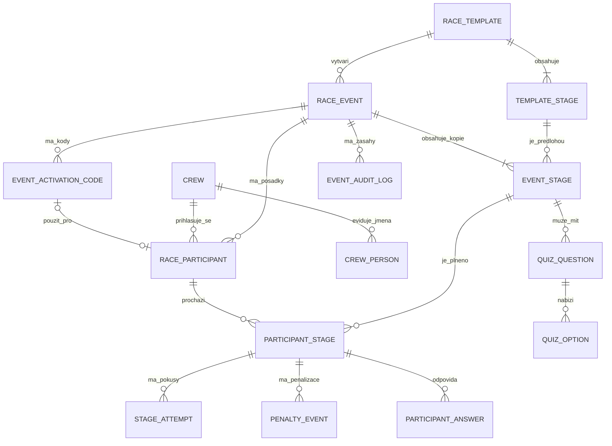
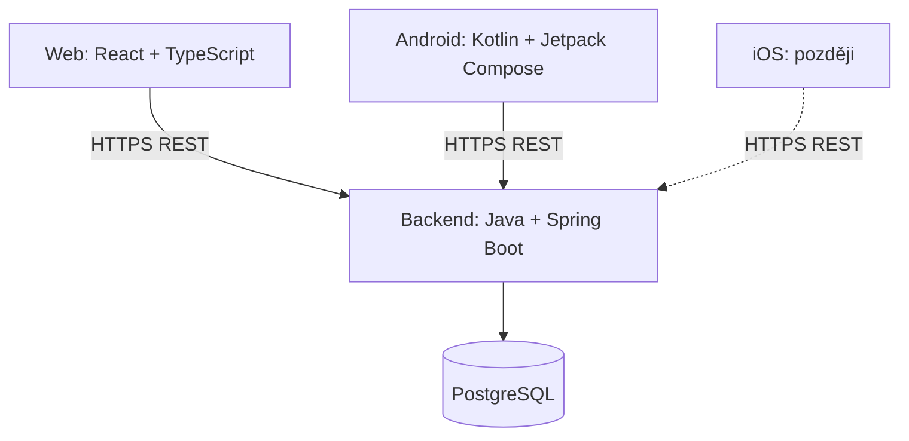

# Systém pro organizaci etapových závodů – funkční a technická specifikace

**Verze:** 0.3.4  
**Datum:** 2026-10-20  
**Stav:** Pracovní návrh; potvrzené požadavky a návrhová doporučení jsou výslovně rozlišeny.

## Historie verzí

| Verze | Datum | Změny |
|---|---|---|
| 0.3.4 | 2026-10-20 | Časová penalizace definována na úrovni stanoviště jako počet bodů za každou započatou jednotku (typicky sekundu či minutu); uzavřena související otevřená otázka. |
| 0.3.3 | 2026-10-20 | Zjednodušena statistika na medián od 5 vzorků; jednoduchý reset statistické verze při podstatné změně stanoviště; potvrzena platnost požadavku přijatého přesně v `end_at`; odstraněny uzavřené otázky. |
| 0.3.2 | 2026-10-20 | Předávání aktivačních kódů mimo aplikaci; přesná idempotence pokusů; přiměřená detekce falešné GPS; sdílené pořadí při úplné shodě; ručně nastavené maximum penalizace stanoviště. Uzavřené otázky odstraněny ze seznamu. |
| 0.3.1 | 2026-10-20 | Potvrzeno nahrazení již udělených penalizací stanoviště maximální penalizací při přeskočení či nedokončení; bez dvojího započtení. |
| 0.3.0 | 2026-10-20 | Jednotná penalizace přeskočení, příkaz v mobilu, přechod ze zrušeného stanoviště bez bodů a časů, vyloučení ze statistik, 5–6znakové kódy, soukromý charakter akcí. |
| 0.2.1 | 2026-10-20 | Příznak dítěte do 15 let je pouze deklarativní při zadávání jmen členů posádky; žádné ověřování věku ani ukládání data narození. |
| 0.2.0 | 2026-10-20 | Trvalé účty posádek, jednorázové aktivační kódy, hromadný start, pevný konec, penalizace nedokončených stanovišť, pořadí, operativní zásahy, GPS spoofing, statistika od 5 vzorků, minimalizace osobních údajů. |
| 0.1.0 | 2026-10-20 | První konsolidované vydání. Zahrnuje posádky jako účty, šablony a konání závodů, kopírování konfigurace, GPS/CODE, DELAYED, očekávané časy, historické robustní statistiky, dashboard a datové modely. |

**Pravidla verzování:** `MAJOR.MINOR.PATCH`. PATCH = upřesnění a opravy bez změny koncepce; MINOR = nové funkční požadavky nebo rozšíření modelu; MAJOR = zásadní změna koncepce. Každé vydání je samostatný soubor `Zavody_specifikace_vX.Y.Z.md`, předchozí vydání se nepřepisují. Změny se zapisují do historie verzí.

## 1. Cíl a rozsah

Systém slouží k vytváření opakovaně použitelných definic automobilových etapových závodů, pořádání konkrétních konání, registraci posádek, jejich vedení přes posloupnost stanovišť, evidenci pokusů a penalizací a sledování průběhu organizátorem. Zpočátku Android; později iOS. Správa přes web. Nízké provozní náklady; desítky až nižší stovky souběžných uživatelů.

## 2. Role, účty a posádky

- **Administrátor:** jediná administrativní role; vykonává zároveň funkce organizátora i správce závodu. V této fázi se tyto role nedělí.
- **Posádka:** trvalý účet použitelný pro účast na více konáních. Jednotliví členové nemají účty ani role.

**Evidence posádky:** `id`, název, e-mailová adresa, počet členů, jména členů, u každého příznak dítěte do 15 let, RZ, popis vozidla, fotografie vozidla a zabezpečené přihlašovací údaje. Počet členů musí odpovídat evidovaným jménům. Pro rozhodování při rovnosti bodů se počítají pouze členové, kteří nejsou dětmi do 15 let. Příznak „dítě do 15 let“ se pouze deklaruje při zadávání jména člena posádky. Systém věk nijak nekontroluje ani neověřuje; údaj se bere na základě důvěry. Datum narození se neeviduje. Pro výsledky konkrétního konání se zachová hodnota příznaku použitá pro dané konání.

**Soukromý charakter akcí:** Jde o neformální akce přátel; nebudeme zavádět zvláštní administrativní agendu souhlasů ani procesy pro veřejné akce. Přiměřená ochrana uložených údajů zůstává zachována.

**Minimalizace osobních údajů:** kromě jmen, e-mailové adresy a RZ se nebudou evidovat další osobní identifikační údaje. Fotografie a popis vozidla jsou součástí evidence automobilu; fotografie může sama obsahovat osobní údaje, proto se s ní musí zacházet odpovídajícím způsobem. Nevyžadovat data narození, adresy, telefonní čísla ani samostatné účty členů.

### 2.1 Přihlášení posádky do konání aktivačním kódem

- Pro každé konkrétní konání administrátor vygeneruje předpokládaný počet **unikátních jednorázových aktivačních kódů**; později lze vygenerovat další.
- Posádka se přihlásí ke svému trvalému účtu a zadáním dosud nepoužitého kódu se zapíše do konkrétního konání.
- Každý kód je vázán na jediné konání a může být **úspěšně uplatněn nejvýše jednou**. Při uplatnění se atomicky přiřadí posádce; paralelní pokusy nesmějí vytvořit dvě účasti.
- Jeden účet posádky se nesmí stejným způsobem přihlásit do téhož konání opakovaně (unikátní vazba `race_event_id + crew_id`).
- Kódy mají **5–6 znaků** z číslic `0–9` a velkých písmen `A–Z`; stačí základní ochrana před opakovaným hádáním.
- **Předání kódu posádce probíhá výhradně mimo aplikaci** (ústně, e-mailem či jiným způsobem); aplikace pouze umožňuje jeho zadání a uplatnění.
- Kódy musí být obtížně uhodnutelné a na serveru bezpečně uložené; administrátor může sledovat jejich stav (volný/použitý), nikoli je automaticky znovu použít.

## 3. Šablona a konkrétní konání

- **`race_template`**: opakovaně použitelná definice závodu; obsahuje posloupnost stanovišť, obsah, pravidla a konfiguraci.
- **`race_event`**: konkrétní konání odvozené ze šablony, zejména s termínem konání, přihlášenými posádkami, průběhem a výsledky.
- Z jedné šablony lze vytvořit libovolný počet konání.
- **Při vytvoření konání se zkopíruje konfigurace stanovišť** do samostatných `event_stage`; pozdější změny šablony již nemění vytvořená konání.
- `event_stage` uchovává vazbu na zdrojové `template_stage` a příslušnou statisticky srovnatelnou verzi definice. To umožní využívat skutečné doby z minulých konání pro budoucí odhady.
- Po zahájení jsou povoleny operativní změny **textu stanoviště** a **zrušení stanoviště**; tyto zásahy jsou auditované a promítnou se do průběhu všech posádek podle pravidel v oddílu 7.3. Ostatní změny konfigurace nejsou bez dalšího schváleny.

## 4. Model závodu a průchod stanovišti

Stanoviště jsou **lineární, uspořádaná posloupnost**. Po dokončení aktuálního se aktivuje další; po posledním se dokončí závod. Mobilní aplikace zobrazí instrukce/obsah (například HTML). Posádka postupuje nezávisle na ostatních.

**Konání zahajuje administrátor hromadně**, z mobilní nebo webové aplikace; server uloží jediný autoritativní čas zahájení. Konání má předem nastavený **pevný čas ukončení**. V tomto čase server uzavře přijímání odpovědí; požadavky doručené **po** hranici odmítne; požadavek přijatý serverem přesně v čase `end_at` je platný. Posádka nemusí dokončit všechna stanoviště; nedokončená se při uzavření penalizují dle oddílu 7.

Aktivací stanoviště začíná měření doby. Úspěšný pokus stanoviště dokončí a zastaví čas. Neúspěšný pokus může přidat penalizaci, ale stanoviště zůstává aktivní a čas pokračuje. Autoritou pro rozhodnutí, časy a body je backend. Závodní posádka obvykle sestává z řidiče a spolujezdce; mobil může během jízdy obsluhovat spolujezdec, interakce během přesunu není obecně zakázána.

### 4.1 Způsoby dokončení

- **GPS:** ověření polohy v nastaveném perimetru.
- **CODE:** zadání správného kódu.
- **QUIZ:** plánované rozšíření; otázky, odpovědi a pravidla dokončení zatím nejsou definitivní.

GPS a CODE se u jednoho stanoviště nemusí kombinovat. Potřebu ověření GPS a následného kódu lze řešit dvěma po sobě jdoucími stanovišti. Časová pravidla jsou **nezávislá** na typu dokončení.

### 4.2 GPS

Stanoviště má souřadnice `latitude`, `longitude`, akceptační poloměr `radius_m` a pevnou penalizaci za neúspěšné ověření mimo perimetr.

- **Bez průběžného nebo background GPS sledování.** Posádka stiskne **Ověřit polohu**; mobil jednorázově získá souřadnice a přesnost a odešle je serveru.
- Server spočítá vzdálenost (např. Haversine) a rozhodne o přijetí.
- **Uvnitř perimetru:** úspěšné dokončení stanoviště a zastavení časování, i pokud bylo dokončeno před minimální dobou.
- **Mimo perimetr:** pevná penalizace; stanoviště není dokončeno a čas pokračuje.
- **Přesnost GPS horší než perimetr (`accuracy_m > radius_m`):** pouze hlášení, poloha se nepoužije, bez penalizace za chybnou polohu. Nedostupná poloha je také technická chyba bez penalizace.
- **Detekovaný aktivní systém falešných souřadnic:** polohu nepoužít, zaznamenat bezpečnostní událost k účasti posádky na serveru, informovat posádku a přidělit nastavenou penalizaci za podvržení. Cílem je odhalit běžné způsoby podvržení, nikoli zaručit úplnou ochranu. Na Androidu se použijí dostupné signály mock-location; na iOS se použijí dostupné platformní prostředky, pokud to bude technicky možné. Neodhalené sofistikované podvržení nelze vyloučit.
- Evidovat každý pokus, čas serveru, polohu, deklarovanou přesnost, vypočtenou vzdálenost, výsledek a případné body. Ochrana proti duplicitám a zpoždění sítě je povinná; detekce podvržení má výše uvedenou reakci.
- Mapa organizátora ukazuje **poslední potvrzené stanoviště**, nikoliv aktuální pohyb posádky.

### 4.3 CODE

Server ověřuje zadaný kód. Správný kód dokončí stanoviště a zastaví čas. Chybný kód přidá nastavené trestné body a stanoviště zůstává aktivní. Správný kód se neposkytuje klientovi.

### 4.4 Časové penalizace

Každé stanoviště může mít v definici volitelnou **časovou penalizaci**. Organizátor nastaví délku penalizačního intervalu (typicky **1 sekunda** nebo **1 minuta**, případně jiná kladná délka v sekundách) a počet trestných bodů za **každý započatý interval**.

`time_penalty_points = ceil(actual_duration_seconds / penalty_interval_seconds) * points_per_interval`

Například při sazbě 3 body za každou započatou minutu a době plnění 125 sekund vzniká penalizace `ceil(125/60) * 3 = 9` bodů. Při nulové době je penalizace nulová. Výpočet probíhá při dokončení stanoviště z autoritativních serverových časů a přičítá se k ostatním platným penalizacím stanoviště; pravidla nahrazení penalizací při přeskočení/nedokončení a pravidla zrušení stanoviště mají přednost. Konfigurace se kopíruje ze šablony do konkrétního konání.

### 4.5 DELAYED – penalizace předčasného dokončení

`DELAYED` **není způsob dokončení ani časová brána**; je to časové pravidlo. Stanoviště se dokončí okamžitě při splnění běžné podmínky, i před uplynutím minimální doby. Předčasnost se pouze penalizuje:

`early_penalty = max(0, minimum_duration_seconds - actual_duration_seconds) * early_penalty_per_second`

Příklad: minimum 900 s, skutečnost 720 s, sazba 2 body/s => 360 bodů. Pokus GPS mimo perimetr stanoviště nedokončí, a proto sám o sobě nevyvolá penalizaci za předčasné dokončení.

## 5. Terminologie a časy

**Závazná terminologie:**

| Název | Význam |
|---|---|
| Čas dokončení stanoviště | Skutečný zaznamenaný časový okamžik dokončení stanoviště |
| Očekávaný čas dokončení stanoviště | Vypočítaný předpokládaný okamžik dokončení stanoviště |
| Čas dokončení závodu | Skutečný zaznamenaný časový okamžik dokončení závodu |
| Očekávaný čas dokončení závodu | Vypočítaný předpokládaný okamžik dokončení závodu |
| Doba plnění stanoviště | Interval od aktivace do dokončení stanoviště |
| Celková doba závodu | Interval od zahájení do dokončení závodu |

**Bez přívlastku „očekávaný“ jde vždy o skutečný čas, nikoliv odhad.**

Pro aktuální stanoviště `k`, čas aktivace `A_k` a odhad doby `D_i`:

- Očekávaný čas dokončení aktuálního stanoviště: `A_k + D_k`.
- Očekávaný čas dokončení závodu: `A_k + sum(D_i, i=k..n)`.

Pokud očekávaný okamžik již uplynul, zobrazí se zpoždění vůči odhadu. Odhady nejsou základem pro trestné body nebo průběžné pořadí.

## 6. Historické statistiky očekávaných dob

Každé stanoviště šablony má organizátorem zadanou **výchozí očekávanou dobu plnění**. Skutečné doby dokončených průchodů **nezrušených stanovišť** z **předchozích i právě probíhajícího konání** se standardně zahrnují do statistiky pro průběžné výpočty a exporty i pro budoucí konání. Výpočet používá stejnou metodiku bez ohledu na konání.

Pro statistiku vybírat **jednotlivé skutečné doby** dokončených průchodů, nikoli průměry jednotlivých konání. Zrušená stanoviště, dobrovolně přeskočené a nedokončené průchody se do statistik nezahrnují.

**Jednoduchý algoritmus očekávané doby:**

1. Pokud jsou k dispozici **méně než 5 platných dokončení**, použít organizátorem ručně zadanou očekávanou dobu stanoviště.
2. Od **5 platných dokončení včetně** použít **medián** skutečných dob. Medián je odolný proti jednotlivým extrémům; žádné dodatečné vyřazování pomocí MAD ani test stability se nezavádí.
3. Započítávají se také platná dokončení z **právě probíhajícího konání**, takže odhad se může průběžně měnit. Odhad je pouze informativní a neovlivňuje body ani pořadí.
4. Všechny skutečné doby se zachovávají v historii, nic se kvůli odhadu nemaže.

**Změna stanoviště:** Běžné úpravy textu zachovávají statistickou historii. Při podstatné změně trasy, místa nebo charakteru úkolu organizátor ručně zvolí **„Resetovat statistiku“**. Tím se zvýší `statistics_version` stanoviště a nové odhady používají pouze průchody příslušné nové verzi. Staré průchody a výsledky zůstávají zachované. Nezavádí se automatická detekce změn ani složitější porovnávání verzí.

Pro zobrazení postačí `sample_count`, `median_duration_s` (pokud existuje) a `expected_duration_s` (efektivní odhad); případně `statistics_version`. Výpočet lze provádět z databáze nebo jednoduchou cache.

## 7. Penalizace, ukončení a konečné pořadí

Každá penalizace je samostatný záznam `penalty_event` s typem, body, zdrojem a důvodem. Kategorie zahrnují GPS mimo perimetr, chybný kód, předčasné dokončení, časovou penalizaci, GPS spoofing, kvíz (pravidla zatím otevřená), přeskočení/nedokončení a případné auditované korekce. Součet aktivních penalizací určuje skóre posádky.

### 7.1 Přeskočená a nedokončená stanoviště

**Konfigurace:** `race_template.skip_penalty_points` je společná hodnota pro celý závod, zkopírovaná do `race_event`. Každé stanoviště má své konečné maximum penalizace; jejich součet se zobrazí před přeskočením.

- Posádka nemusí absolvovat všechna stanoviště.
- Mobilní aplikace poskytne příkaz **„Přeskočit stanoviště“**. Před potvrzením zobrazí **celkovou penalizaci** (maximum stanoviště + jednotná penalizace závodu). Po potvrzení se stanoviště přeskočí a aktivuje následující. Posádka se nesmí zaseknout na jediném stanovišti.
- Za **přeskočené stanoviště posádkou** se přidělí **maximální možná bodová penalizace konkrétního stanoviště + jednotná penalizace za přeskočení**. **Dosavadní penalizace získané na tomto stanovišti se touto výslednou penalizací nahrazují, nepřičítají se k ní.** Původní události zůstávají v auditní historii, ale nevstupují do aktivního bodového součtu. Jednotná penalizace se nastaví pouze jednou v konfiguraci šablony závodu a kopíruje se do konání.
- Při dosažení pevného času ukončení konání se obdobně penalizují **všechna nedokončená stanoviště**, včetně právě aktivního. Aktivované, ale nesplněné stanoviště je stále nedokončené.
- **Maximální bodová penalizace každého stanoviště se zadává ručně v definici stanoviště** (`template_stage.max_penalty_points`) a kopíruje do konání. Je to autoritativní hodnota pro přeskočení či nedokončení, nezávislá na počtu pokusů a délce trvání. Není nutné ji dopočítávat z dílčích pravidel.
- Penalizace za nedokončení se přidělí právě jednou, transakčně a idempotentně. **Také při nedokončení z důvodu konce závodu nahrazuje výsledná penalizace dosavadní penalizace konkrétního stanoviště**; původní události zůstávají auditovatelné, ale nejsou znovu započítány.
- **Zrušení stanoviště organizátorem** je odlišné od přeskočení posádkou a **nesmí být penalizováno** (viz 7.3).

### 7.2 Konečné pořadí

1. Posádky se řadí vzestupně podle **celkového počtu trestných bodů**.
2. Při rovnosti bodů se lépe umístí posádka s **menším počtem započítávaných členů**; děti do 15 let se do tohoto počtu **nezahrnují**.
3. Při úplné shodě bodů i započítávaného počtu členů **posádky sdílejí stejné umístění**; další rozřazovací kritérium se nepoužije.

Průběžné pořadí se nepočítá. Konečné výsledky lze stanovit po serverovém ukončení konání a dokončení závěrečných penalizací.

### 7.3 Operativní zásahy organizátora

Administrátor může během běžícího konání kvůli místní situaci:

- **upravit text stanoviště**; aktualizovaný text se zobrazí posádkám;
- **zrušit stanoviště**; jeho text se změní na instrukce, jak pokračovat k následujícímu stanovišti, a stanoviště se pro účely hodnocení stává neutrálním.

**Na zrušeném stanovišti** mobilní aplikace zobrazí instrukce pro přechod na další stanoviště a tlačítko **„Zobrazit další stanoviště“**. Stisknutí aktivuje následující stanoviště a jeho časování. Pro zrušené stanoviště se **neaplikují žádné body ani časy**.

**Zrušené stanoviště se nehodnotí žádné posádce:** nezapočítají se žádné jeho penalizace **ani bonusy**, včetně posádek, které jej již dříve dokončily. Historie původních pokusů a bodových událostí zůstává zachována pro audit, ale je vyřazena z účinného skóre. Posádky na zrušeném stanovišti přejdou uvedeným tlačítkem. **Zrušená stanoviště se zcela vylučují ze statistik dob plnění**, včetně průchodů dokončených před zrušením. Všechny zásahy se auditují a změny se promítnou do dashboardu.

## 8. Webový dashboard organizátora

Zobrazuje mapu stanovišť, poslední potvrzené dokončené stanoviště každé posádky (nikoliv průběžnou polohu), a tabulku:

- posádka a stav;
- poslední dokončené a aktuální stanoviště;
- poslední aktivita;
- dosavadní trestné body;
- **očekávaný čas dokončení aktuálního stanoviště**;
- **očekávaný čas dokončení závodu**;
- případné zpoždění proti odhadu.

Po kliknutí na posádku lze zobrazit průchod, historii pokusů a penalizací. Stanoviště mohou na mapě agregovat počet posádek. **Žádné průběžné pořadí.**

### 8.1 Aktualizace dashboardu

Uživatel nastavuje interval automatické aktualizace. **Potvrzené hodnoty:** 5, 10, 15, 30 nebo 60 sekund; výchozí 10 sekund. Lze vypnout automatické aktualizace a obnovovat ručně. Volba se uchovává pro uživatele; dashboard zobrazuje čas poslední úspěšné aktualizace. V první verzi REST polling; SSE/WebSocket pouze případné pozdější rozšíření.

## 9. Mobilní aplikace

Přihlášení trvalého účtu posádky; dobrovolné přeskočení s náhledem celkové penalizace; pokračování ze zrušeného stanoviště bez bodů a časů; uplatnění jednorázového aktivačního kódu pro konkrétní konání; výběr účasti v konání; aktuální stanoviště a instrukce; měření doby; jednorázové GPS ověření; zadání kódu; později kvíz; zobrazení výsledku pokusu, penalizací, historie a dokončení závodu. Není požadováno GPS na pozadí. Offline dokončování zatím není stanoveno; první návrh počítá s připojením pro ověřování.

## 10. Logický datový model



### 10.1 Klíčové entity a pole (pracovní návrh)

| Entita | Vybraná pole / účel |
|---|---|
| `app_user` | `id`, e-mail/přihlašovací identita, autentizace; jediná administrativní role |
| `crew` | `id`, `name`, `participant_count`, `vehicle_registration`, `vehicle_description`, `vehicle_photo_ref`, `email`, autentizační identita |
| `crew_person` | `id`, `crew_id`, `name`, `is_child_under_15`; evidenční osoba bez účtu |
| `race_template` | `skip_penalty_points` (jednotná penalizace za přeskočení), `id`, `name`, `description`, stav, vlastník |
| `template_stage` | `id`, `race_template_id`, `sequence_no`, `name`, `content`, `completion_type`, `config_json`, `expected_duration_s`, `statistics_version`, `max_penalty_points` (ručně zadané maximum) |
| `race_event` | `id`, `race_template_id`, `name`, `scheduled_at`, `end_at` (pevná uzávěrka), `started_at` (hromadný start), `status`, `ended_at` |
| `event_activation_code` | `id`, `race_event_id`, `code_hash`, `status`, `redeemed_by_participant_id`, `redeemed_at`; unikátní jednorázový kód |
| `event_stage` | `id`, `race_event_id`, `template_stage_id`, `statistics_version`, kopie pořadí/obsahu/konfigurace |
| `race_participant` | `id`, `race_event_id`, `crew_id`, `status`, `current_stage_id`, `last_completed_stage_id`, `total_penalty_points` (cache), `last_activity_at`, `completed_at`, `spoofing_detected_at` (nebo vazba na bezpečnostní události) |
| `participant_stage` | `id`, `race_participant_id`, `event_stage_id`, `status`, `activated_at`, `completed_at`, `duration_ms`, `total_penalty_points`, `version` |
| `stage_attempt` | `id`, `participant_stage_id`, `attempted_at`, `attempt_type`, `result`, `latitude`, `longitude`, `accuracy_m`, `distance_m`, `penalty_points`, `idempotency_key` (unikátní v kontextu posádky/pokusu) |
| `penalty_event` | `id`, `race_participant_id`, `participant_stage_id`, `stage_attempt_id` (volitelné), `penalty_type`, `points`, `created_at`, `reason` |
| `quiz_question`, `quiz_option`, `participant_answer` | budoucí kvízový model |
| `event_audit_log` / `audit_log` | kdo/co/kdy změnil; změny textů, zrušení stanovišť, neutralizace bodů, čas a důvod |
| `security_event` | identifikace účasti, čas a druh detekovaného podvržení GPS; bez nadbytečných osobních údajů |

**Stavy průchodu:** návrh `PENDING`, `ACTIVE`, `COMPLETED`, `SKIPPED_BY_CREW`, `NOT_COMPLETED_AT_DEADLINE`, `CANCELLED_BY_ORGANIZER`. Poslední stav neutralizuje body, nikoli maže historii. Stavový automat bude dopracován.

**Stavy konání:** návrh `PLANNED`, `RUNNING`, `ENDED`; hromadný start a uzavření provádí server atomicky. Při uzavření proběhne závěrečné vyhodnocení i bez dalšího klientského požadavku (serverový plánovač / transakční finalizace).

### 10.2 Příklad konfigurace GPS stanoviště

```json
{
  "completionType": "GPS",
  "location": {"latitude": 50.123456, "longitude": 14.123456, "radiusMeters": 100},
  "timing": {"expectedDurationSeconds": 1200, "minDurationSeconds": 900, "earlyPenaltyPerSecond": 2},
  "penalties": {"outsidePerimeter": 5}
}
```

Konkrétní datový kontrakt není schválen. JSONB je doporučen pro typově specifickou konfiguraci; relační identifikátory a pořadí zůstávají v běžných sloupcích. Tajné kódy a správné odpovědi nejsou zpřístupněny mobilnímu klientovi.

## 11. Návrh REST API (orientační)

| Metoda | Endpoint | Účel |
|---|---|---|
| GET/POST | `/api/v1/race-templates` | seznam / vytvoření šablony |
| GET/PATCH | `/api/v1/race-templates/{id}` | detail / úprava šablony |
| GET/POST | `/api/v1/race-templates/{id}/stages` | správa stanovišť šablony |
| POST | `/api/v1/race-templates/{id}/events` | vytvoření konání a kopií stanovišť |
| GET | `/api/v1/race-events/{id}` | detail konání |
| POST | `/api/v1/race-events/{id}/activation-codes/batches` | dogenerování unikátních kódů |
| POST | `/api/v1/race-events/{id}/start` | hromadné zahájení konání (administrátor) |
| POST | `/api/v1/race-events/{id}/stages/{stageId}/cancel` | zrušení stanoviště a neutralizace bodů |
| PATCH | `/api/v1/race-events/{id}/stages/{stageId}/content` | operativní úprava textu |
| POST | `/api/v1/race-events/{id}/join` | uplatnění kódu trvalým účtem posádky |
| GET | `/api/v1/race-events/{id}/dashboard` | živý dashboard |
| GET | `/api/v1/race-events/{id}/results` | výsledky konání |
| GET | `/api/v1/participations/{id}/current-stage` | aktuální stanoviště posádky |
| POST | `/api/v1/participations/{id}/attempts` | idempotentní pokus o dokončení |
| GET | `/api/v1/participations/{id}/progress` | průběh a penalizace |
| GET | `/api/v1/race-templates/{id}/stage-statistics` | historické statistiky |

Autorizace musí vždy ověřovat práva k dané šabloně, konání nebo posádce. Názvy endpointů jsou pracovní.

## 12. Architektura a technologie



- **Backend:** Java (preferovaně současná LTS), Spring Boot, embedded Tomcat, Spring Security, Spring Data JPA/Hibernate, Flyway, OpenAPI.
- **Web:** React + TypeScript; mapa Leaflet nebo MapLibre.
- **Android:** Kotlin + Jetpack Compose; jednorázové GPS přes platformní lokalizační API.
- **Databáze:** PostgreSQL; JSONB pro typově specifická pravidla; PostGIS není při předpokládaném zatížení nezbytný.
- **Provoz:** jednoduchý modulární monolit, Docker Compose na levném VPS nebo vhodné free-tier infrastruktuře. Bez potřeby mikroslužeb či Kubernetes.
- **CI/CD:** návrh GitHub Actions; zálohy DB mimo provozní server.

## 13. Spolehlivost, bezpečnost a audit

- HTTPS, bezpečné ukládání autentizačních údajů, autorizace na úrovni zdrojů.
- Serverový čas je autoritativní; čas aktivace/dokončení i penalizace se zpracují transakčně.
- **Idempotence pokusů:** mobil při vytvoření každého nového odesílacího pokusu vygeneruje unikátní `idempotency_key` (např. UUID) a lokálně uchová požadavek i klíč jako nepotvrzený. Při síťové chybě nebo timeoutu odešle **tentýž požadavek se stejným klíčem**; nový skutečný pokus dostane nový klíč. Po potvrzení výsledku serverem mobil požadavek označí za zpracovaný. Server má pro klíč unikátní databázové omezení, transakčně uloží výsledek a opakované doručení téhož klíče **nikdy znovu neprovede**: vrátí původní výsledek bez dalšího přechodu či penalizace. Stejný klíč s jiným obsahem je chyba požadavku. Platí také pro příkazy přeskočení a jiné stavové operace.
- Současné pokusy o dokončení téhož stanoviště nesmějí aktivovat další stanoviště vícekrát.
- Audit konfigurace, zásahů organizátora a změn bodů.
- Ochrana tajných kódů, odpovědí a osobních údajů posádek včetně fotografií.
- GPS s přesností horší než perimetr se nepoužije a nepenalizuje; detekovaný aktivní systém falešné polohy se zapíše, oznámí a penalizuje bez použití polohy. Technické limity detekce je nutné respektovat.
- Server vynucuje pevný konec konání a odmítá opožděné odpovědi; konečné penalizace se vyhodnocují bez ohledu na aktivitu klientů.
- Zpracování jednorázového aktivačního kódu musí být transakční a odolné proti souběhu.
- Minimalizace osobních údajů: jména, e-mail, RZ; evidence fotografie vozidla dle požadavku, zabezpečené uchovávání a retence.
- Testy: jednotkové, integrační, transakční a vybrané zátěžové.

## 14. Skutečně otevřené otázky

1. **Kvízy:** typy otázek, způsob vyhodnocení, podmínky dokončení a penalizace.

**Uzavřená pravidla (nejsou otevřenými otázkami):** Požadavek je včasný, pokud serverový čas přijetí `received_at <= end_at`. Po uzávěrce je nové zpracování odmítnuto, ale opakování již dříve přijatého požadavku se stejným idempotentním ID vrací uložený výsledek bez nového zpracování.

## 15. Zásady pro další revize

Při každé odsouhlasené změně:

1. Aktualizovat úplnou specifikaci, nejen samostatný dodatek.
2. Zvýšit verzi dle rozsahu změny.
3. Přidat stručný řádek do historie verzí.
4. Zachovat starší vydání jako samostatný soubor.
5. Rozlišit potvrzený požadavek od návrhu nebo otevřené otázky.

