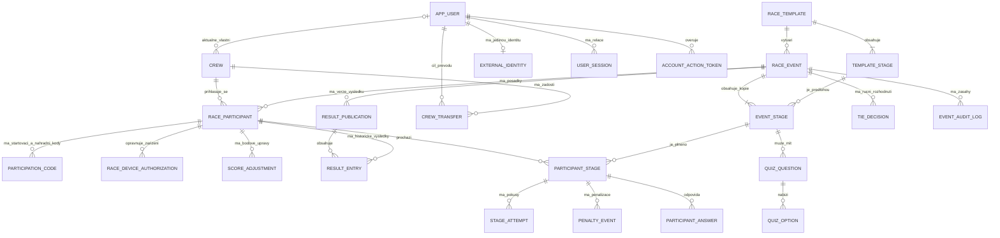
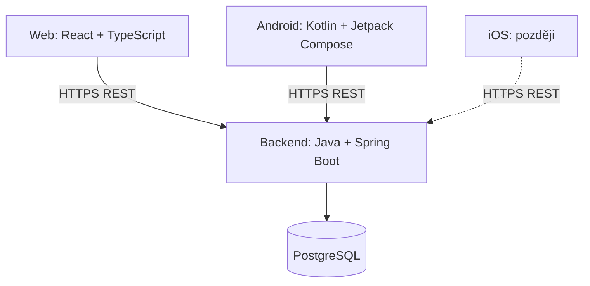

# Systém pro organizaci etapových závodů – funkční a technická specifikace

**Verze:** 0.8.0
**Datum:** 2026-10-24
**Stav:** Pracovní návrh; potvrzené požadavky a návrhová doporučení jsou výslovně rozlišeny.

V rámci vydání 0.6.0 byla doplněna následně schválená rozhodnutí 3b o historickém kapitánství, rušení účtů, přiřazování kapitánů, auditním úklidu, CSV exportu a 24hodinové idempotenci. Pravidla bezpečnostního auditu byla následně výslovně změněna schválením etapy 3b.5: automatická retence 365 dní s konfigurovatelným minimem 90 dní a best-effort audit dokončeného exportu. Tato pravidla vydání 0.6.0 se přebírají beze změny. Vydání 0.7.0 přidává schválená rozhodnutí 3c-D01–D08 o externím přihlášení a správě identit. Vydání 0.8.0 nahrazuje pravidla D04 a D05 rozhodnutím 3c-D09: právě jedna neměnná přihlašovací identita. D10 nahrazuje D03: LOCAL zrušení vyžaduje znovu heslo; GOOGLE/APPLE platnou relaci a samostatné výslovné potvrzení bez externí reautentizace. 3c.1 a 3c.2 jsou implementačně dokončené a lokálně ověřené podle tehdejšího rozsahu; omezení jediné neměnné identity v databázi teprve čeká na implementaci. Skutečné Google/Apple přihlášení není ověřeno. Technický návrh a jeho dosud neověřené podmínky jsou v [external-auth-3c.md](external-auth-3c.md).

## Historie verzí

| Verze | Datum | Změny |
|---|---|---|
| 0.8.0 | 2026-10-24 | D09 nahrazuje D04/D05: právě jedna neměnná LOCAL/GOOGLE/APPLE identita, bez link/unlink a dodatečného LOCAL. D10 nahrazuje D03: LOCAL heslo, externí relace s výslovným potvrzením; bez čerstvých grantů. |
| 0.7.0 | 2026-10-24 | Schválená rozhodnutí 3c-D01–D08: ověření externího e-mailu a dokončení registrace, čerstvé ověření, úplná správa nejvýše jedné identity každého typu, šifrovaný Apple revokační prostředek, HTTPS testovací prostředí a jednorázové mobilní předání s PKCE. |
| 0.6.0 | 2026-10-21 | Schválená pravidla 3b: posádky a fotografie, běžné i administrátorské převody, role ADMIN a bootstrap, rušení účtů, audit a jeho ruční úklid, Idempotency-Key. |
| 0.5.0 | 2026-10-21 | Samostatné účty a relace, ověření e-mailu a obnova hesla; více posádek, převody a historický název; textový seznam členů a počet dětí; přihlášky přes odkaz, startovací/náhradní kódy a zařízení; ruční remízy, publikace a veřejný archiv výsledků. |
| 0.4.0 | 2026-10-21 | Interní účet kapitána, více způsobů přihlášení a bezpečné propojení identit; členové výhradně u účasti, nezávislé kopie a uzamčení; výjimečné pozdní přihlášení; milisekundy, celé body a soutěžní pořadí; zrušení posledního stanoviště. |
| 0.3.4 | 2026-10-20 | Časová penalizace definována na úrovni stanoviště jako počet bodů za každou započatou jednotku (typicky sekundu či minutu); uzavřena související otevřená otázka. |
| 0.3.3 | 2026-10-20 | Zjednodušena statistika na medián od 5 vzorků; jednoduchý reset statistické verze při podstatné změně stanoviště; potvrzena platnost požadavku přijatého přesně v `end_at`; odstraněny uzavřené otázky. |
| 0.3.2 | 2026-10-20 | Předávání aktivačních kódů mimo aplikaci; přesná idempotence pokusů; přiměřená detekce falešné GPS; sdílené pořadí při úplné shodě; ručně nastavené maximum penalizace stanoviště. Uzavřené otázky odstraněny ze seznamu. |
| 0.3.1 | 2026-10-20 | Potvrzeno nahrazení již udělených penalizací stanoviště maximální penalizací při přeskočení či nedokončení; bez dvojího započtení. |
| 0.3.0 | 2026-10-20 | Jednotná penalizace přeskočení, příkaz v mobilu, přechod ze zrušeného stanoviště bez bodů a časů, vyloučení ze statistik, 5–6znakové kódy, soukromý charakter akcí. |
| 0.2.1 | 2026-10-20 | Příznak dítěte do 15 let je pouze deklarativní při zadávání jmen členů posádky; žádné ověřování věku ani ukládání data narození. |
| 0.2.0 | 2026-10-20 | Trvalé účty posádek, jednorázové aktivační kódy, hromadný start, pevný konec, penalizace nedokončených stanovišť, pořadí, operativní zásahy, GPS spoofing, statistika od 5 vzorků, minimalizace osobních údajů. |
| 0.1.0 | 2026-10-20 | První konsolidované vydání. Zahrnuje posádky jako účty, šablony a konání závodů, kopírování konfigurace, GPS/CODE, DELAYED, očekávané časy, historické robustní statistiky, dashboard a datové modely. |

**Pravidla verzování:** `MAJOR.MINOR.PATCH`. PATCH = upřesnění a opravy bez změny koncepce; MINOR = nové funkční požadavky nebo rozšíření modelu; MAJOR = zásadní změna koncepce. Každé vydání je samostatný soubor `Zavody_specifikace_vX.Y.Z.md`, předchozí vydání se nepřepisují. Změny se zapisují do historie verzí.

## 1. Cíl a rozsah

Systém slouží k vytváření opakovaně použitelných definic automobilových etapových závodů, pořádání konkrétních konání, registraci posádek, jejich vedení přes posloupnost stanovišť, evidenci pokusů a penalizací a sledování průběhu organizátorem. Zpočátku Android; později iOS. Správa přes web. Nízké provozní náklady; desítky až nižší stovky souběžných uživatelů.

## 2. Uživatelské účty, posádky a přihlášky

- **Uživatelský účet:** samostatný účet s neměnným interním ID, zobrazovaným jménem a kontaktním e-mailem; LOCAL používá e-mail i jako přihlašovací jméno, externí identitu určuje provider/issuer/subject.
- **Administrátor:** jediná administrativní role, která plní funkce organizátora i správce závodu.
- **Kapitán:** aktuální vlastník posádky. Jeden účet může vlastnit více posádek. Každá posádka má nejvýše jednoho aktuálního kapitána; posádky mohou existovat i bez kapitána.
- **Posádka:** trvalá evidence použitelná pro více konání, bez vlastních přihlašovacích údajů a bez trvalého seznamu členů. Členové účasti nejsou uživatelské účty.

### 2.1 Přihlášení, ověření a relace

Přihlášení e-mailem a heslem, Google nebo Sign in with Apple. Každý aktivní interní účet má právě jednu použitelnou přihlašovací identitu LOCAL, GOOGLE nebo APPLE, určenou při vytvoření účtu. Její typ ani konkrétní identitu nelze později změnit, nahradit, připojit další ani odpojit. K externímu účtu nelze dodatečně přidat místní heslo. Shoda e-mailu účty nikdy nepropojí. Z externích poskytovatelů přebírat pouze jméno, e-mail a nezbytný technický identifikátor identity, nikdy jejich hesla. Apple může poskytovat skrytou adresu a jméno nemusí při dalším přihlášení vrátit; chybějící jméno nesmí smazat již uložené.

Registrace uživatelského účtu e-mailem vyžaduje ověření adresy jednorázovým aktivačním odkazem zaslaným e-mailem. Tento odkaz neslouží k přihlášení posádky do závodu ani ke startu či převzetí rozehraného závodu. Neúspěšné přihlášení neprozradí, zda je chybně e-mail, nebo heslo. Žádost o obnovu hesla nesmí prozradit existenci účtu. Obnova používá jednorázový odkaz platný **30 minut**. Změna e-mailu vyžaduje opětovné ověření uživatele a potvrzení nové adresy; změna e-mailu nemění interní ID účtu.

Checkbox **„Zůstat přihlášený“** je standardně nezaškrtnutý. Současné přihlášení na více zařízeních je povolené. Změna hesla zneplatní ostatní relace, obnova hesla všechny relace. Bez zaškrtnutí přihlášení platí pouze po dobu aktuální relace aplikace nebo prohlížeče. Se zaškrtnutím může přetrvat až 30 dní a při používání se prodlužovat. Odhlášení okamžitě zneplatní příslušnou relaci na serveru; relace na různých zařízeních jsou nezávislé. Přihlášení do účtu není totéž co oprávnění konkrétního zařízení pokračovat v rozehraném závodě.

Historická účast uživatele vzniká vazbou na uživatele, který byl kapitánem posádky v okamžiku skutečného zahájení závodu. Pouhá přihláška historickou účastí není. Pozdější převod kapitána tuto vazbu původního kapitána nemění. Datový model ji musí trvale zachovat odděleně od aktuálního vlastníka posádky.

Při zrušení účtu bez historické účasti se účet trvale smaže; s historickou účastí se anonymizuje a výsledky se zachovají. Odstraní nebo anonymizují se osobní údaje samotného účtu, zejména e-mail, zobrazované jméno a přihlašovací identity; zneplatní se jeho relace a přihlašovací/tokenové prostředky. Automaticky se zruší všechny čekající převody, kde rušený uživatel vystupuje jako původní nebo cílový kapitán. Všechny posádky rušeného uživatele zůstanou zachované bez kapitána, i když nemají historickou účast.

Pokud je posádka pouze přihlášená do závodu, je zrušení účtu povoleno a přihláška zůstane zachována. Pokud právě závodí, zrušení účtu se nepovolí, dokud její účast neskončí. Po dokončení závodu se zrušení účtu řídí anonymizací kvůli historické účasti; rozhoduje trvalá historická vazba, nikoli pozdější vlastnictví. Posádka bez kapitána nemůže podat novou přihlášku, ale již existující přihláška se zrušením účtu neruší.

Historické posádky, názvy, výsledky a seznamy jmen členů v historických přihláškách pro interní evidenci a diplomy zůstávají zachované. Jména členů nejsou veřejná. Administrátor může zrušit účet podle stejných pravidel jako uživatel, bez obejití ochrany historie, běžící účasti či posledního administrátora. Zrušení převodů, odpojení kapitána, smazání/anonymizace a audit tvoří transakčně konzistentní operaci; při odmítnutí zrušení účtu se neprovedou částečné změny.

### 2.1.1 Externí přihlášení – schválená rozhodnutí 3c

Rozhodnutí 3c-D09 v tomto vydání nahrazuje D04 a D05 z 0.7.0, D10 nahrazuje D03; nejde o souběžně platné varianty. Jejich původní znění zůstává pouze v historickém vydání 0.7.0.

Následující pravidla doplňují 2.1 a mají přednost před staršími technickými návrhy. Neznamenají, že již existují příslušné endpointy nebo migrace.

- **3c-D01 – e-mail:** při první registraci přes Google/Apple je adresa ověřena pouze spolehlivým validovaným údajem poskytovatele. Jinak se vyžaduje vlastní ověření e-mailu. Shoda e-mailu nikdy automaticky nepropojuje účty; vlastní místní registrace nadále vyžaduje aktivační odkaz.
- **3c-D02 – dokončení registrace:** chybějící povinné jméno nebo použitelný e-mail doplní uživatel v samostatném kroku. Uživatelem doplněný e-mail se ověřuje vlastní cestou. Před dokončením registrace se nevydá plnohodnotná přihlašovací relace. Chybějící údaje poskytovatele při opakovaném přihlášení existující identity nepřepisují uložené hodnoty.
- **3c-D03 – nahrazeno D10:** původní požadavek externího čerstvého ověření a pětiminutových účelových oprávnění se pro zrušení účtu již nepoužije. Správa více identit odpadla podle D09.
- **3c-D04 – nahrazeno D09:** původní správa více způsobů, link/unlink a přidání LOCAL již nejsou povolené. Obnova hesla zůstává pouze pro již existující LOCAL identitu.
- **3c-D05 – nahrazeno D09:** původní limit jedné identity každého typu nahrazuje limit právě jedné identity celkem. Globální unikátnost (provider, issuer, subject) zůstává zachována.
- **3c-D09 – jediná neměnná identita:** právě jedna použitelná identita u každého aktivního účtu. LOCAL identita zachovává možnost změny a obnovy svého hesla; nejde o výměnu identity. Jméno a kontaktní e-mail jsou profilové údaje, jejich změna nesmí změnit identitu; tímto vydáním se nezavádí API změny e-mailu. Externí identitu určuje (provider, issuer, subject), nikoliv e-mail. Ztráta identity poskytovatele ani změna subjectu neopravňuje k automatickému převodu účtu. Při řádném zrušení se identita odstraní; anonymizovaný historický účet již přihlašovací identitu nemá. Nová registrace je nový účet bez původních práv.
- **3c-D10 – potvrzení vlastního zrušení:** u LOCAL je nutná platná relace a opětovné zadání a ověření aktuálního hesla. U GOOGLE/APPLE postačí platná autentizovaná relace a samostatné výslovné potvrzení uživatele. Externí auth_time, max_age ani nové přihlášení se nevyžadují. Potvrzení není novým ověřením identity, jde o vědomě přijatý bezpečnostní kompromis. Zachovávají se CSRF, audit, transakční konzistence, zneplatnění všech relací a další dosavadní ochrany. ADMIN cesta ověřuje jednajícího administrátora, ne heslo cíle; D10 jí nově neukládá čerstvou reautentizaci. Apple revokace při zrušení včetně administrátorského zůstává povinná podle D06, implementace v 3c.5.
- **3c-D06 – Apple revokace:** bezpečně uchovávat pouze nezbytný revokační prostředek, šifrovaně a s omezeným přístupem. Při zrušení účtu včetně administrátorského zajistit revokaci autorizace u Apple. Lokální databázová transakce je oddělená od externího volání; dočasný výpadek vede k bezpečnému opakování bez obnovy zrušeného účtu. Správa klíčů, retence a bezpečné odstranění prostředků musejí být součástí technického řešení. Nejde o ukládání tokenů do idempotentního ledgeru ani změnu jeho šifrování.
- **3c-D07 – ověření:** skutečné integrační ověření Apple používá samostatnou HTTPS testovací doménu. Nyní se nezřizuje doména ani infrastruktura. Automatické testy se simulovaným poskytovatelem se vykazují odděleně od skutečného ověření.
- **3c-D08 – mobil:** společný backendový OAuth2/OIDC authorization code tok přes systémový prohlížeč. Autorizační stav platí **10 minut**; mobil obdrží pouze jednorázový předávací kód platný **60 sekund** a vymění jej s **PKCE S256** za existující Rallye Bearer relaci. Jen explicitně konfigurované návratové adresy, Bearer nikdy v návratové URL. Expirace ani jednorázovost se opakováním neprodlužují.

Oprávnění, vlastnictví, historické vazby a ADMIN zůstávají navázané na neměnné interní ID. Externí přihlášení nemění pravidla 24hodinové/30denní nečinnosti, více relací, změny/resetu hesla a ochrany historie či posledního administrátora. Úplné zrušení ruší i nové přihlašovací kontexty; nezbytná chráněná práce na Apple revokaci může doběhnout po odstranění účtu, nesmí obnovit jeho data nebo práva.

### 2.2 Trvalá posádka a převod kapitána

Evidence posádky: ID, aktuální kapitán (může chybět), povinný název do **100 znaků**, nepovinná RZ do **32 znaků**, nepovinný popis do **2 000 znaků** a nepovinná fotografie vozidla. Jeden účet může vlastnit více posádek. Název ani RZ nemusí být unikátní. Název lze změnit; u konkrétního závodu se zachová název z okamžiku přihlášení. Posádka se může účastnit více konání, ale v jednom konání nejvýše jednou (unikátní `race_event_id + crew_id`). Posádku bez jakékoli účasti lze smazat, pokud nemá čekající převod; posádku s historickou účastí nelze smazat ani administrátorem. **Archivace posádek se nezavádí.**

Fotografie jsou pouze **JPEG/PNG**, nejvýše **5 MiB (5 242 880 bajtů)** a **4096 × 4096 pixelů** (každý rozměr nejvýše 4096 px). Ukládají se do soukromého souborového úložiště; nejsou veřejnými soubory a přístup musí být autorizovaný. Detaily bezpečného zpracování souborů jsou technickým návrhem v backend-plan.md.

Běžný uživatel zakládá posádku vždy se sebou jako kapitánem. Administrátor může založit posádku pro libovolného existujícího aktivního uživatele s ověřeným e-mailem nebo bez kapitána. Administrátor může existující posádce kapitána odebrat; běžný uživatel jej přímo odebrat nemůže.

Kapitán může zahájit převod zadáním e-mailu existujícího aktivního uživatele s ověřeným e-mailem. Převod na sebe sama není povolen; jeden uživatel může být kapitánem více posádek. Novému kapitánovi přijde jednorázový odkaz platný **7 dní**. Po přihlášení ke správnému účtu převod přijme nebo odmítne. Přijetí atomicky změní vlastníka: nový kapitán okamžitě získá oprávnění ke správě posádky včetně jejích účastí, původní tato správcovská oprávnění ztratí. Historické názvy ani výsledky se převodem nemění. Čekající žádost může zrušit původní kapitán. Během čekajícího převodu jsou úpravy posádky povoleny, její smazání je zakázáno. Převod je vázán na interní ID cílového účtu, nikoli na měnitelný e-mail; změna e-mailu nemění cílový účet žádosti. Na posádku může existovat nejvýše jedna aktivní žádost. Převody a jejich rozhodnutí se auditují. Převod kapitána nemění aktivní závodní zařízení: rozehraný závod pokračuje na dosavadním zařízení. Vlastnictví posádky a oprávnění zařízení k závodní účasti jsou oddělené. Změna závodního zařízení nadále vyžaduje náhradní startovací kód vydaný administrátorem.

Administrátor může kapitána změnit okamžitě bez potvrzení novým kapitánem. Cílem však musí být existující aktivní uživatel s ověřeným e-mailem a převod na sebe sama není povolen; výjimka se týká pouze potvrzení, nikoli podmínek cíle. Případný čekající převod se administrátorskou změnou nebo odebráním kapitána zruší; změna vlastníka, zrušení žádosti a audit musí být atomické. Ani tato změna nemění oprávnění aktuálního závodního zařízení.

### 2.3 Přístup ke konání a podání přihlášky

Plánované a probíhající závody nejsou veřejně nabízeny. Organizátor předává odkaz na konkrétní závod mimo aplikaci, například e-mailem. Přihlášku za svou posádku může podat každý registrovaný uživatel s odkazem, pokud splňuje pravidla registrace. Seznam povolených e-mailů se nezavádí. Odkaz nenahrazuje autentizaci ani jednorázový startovací kód. **Registraci posádky do závodu provádí přihlášený kapitán bez aktivačního kódu. Toto pravidlo neruší ověření e-mailu při registraci uživatelského účtu jednorázovým aktivačním odkazem.** Kódy pro start a výměnu zařízení jsou popsány v oddílu 4.7.

### 2.4 Členové konkrétní účasti

Přihláška obsahuje jedno víceřádkové textové pole: jeden člen na řádku. Při vytvoření se předvyplní zobrazované jméno kapitána, které lze libovolně změnit. Počet členů odpovídá počtu neprázdných řádků. Minimálně jeden člen; maximum se nastavuje v konfiguraci závodu, výchozí hodnota **5**.

Samostatné celočíselné pole `children_under_15` udává počet dětí mladších 15 let, které jsou již zahrnuté v seznamu. Musí být mezi nulou a počtem členů. Počet účastníků 15+ je počet členů minus `children_under_15`. Věk se deklaruje bez ověřování a bez data narození. **Samostatná tabulka členů, příznaky dítěte u jednotlivých jmen ani funkce změny pořadí členů se nezavádějí.**

Při nové přihlášce lze zkopírovat seznam z libovolné předchozí účasti téže posádky, včetně nedokončené. Vzniká nezávislá kopie, změny neovlivňují historii. Zda tlačítko přebírá i agregovaný počet dětí, je k upřesnění. Seznam a údaje rozhodné pro složení lze upravovat do oficiálního zahájení, pak se složení již přihlášených účastí uzamkne. Dřívější pravidlo pozdní účasti zůstává v platnosti: její složení se uzamkne při zařazení.

### 2.5 Uzavření účasti a pozdní přihlášení

Standardně se přihlašování uzavírá při oficiálním startu. Organizátor může výjimečně povolit zařazení nové posádky po startu, pouze do konce konání. Výjimka se audituje. Společný `end_at` se nemění a uplynulý čas se nekompenzuje. Pozdní přihlášení je odlišné od pozdního uplatnění startovacího kódu již přihlášené posádky. Rozsah výjimky a hraniční okamžik jejího přijetí zůstávají k upřesnění.

### 2.6 Soukromý charakter a osobní údaje

Jde o soukromé neformální akce přátel, bez zvláštní administrativní agendy souhlasů pro veřejné akce. Plánovaná/probíhající konání nejsou veřejně nabízena, ale publikované definitivní výsledky a archiv minulých závodů jsou veřejné bez přihlášení. Veřejně se zobrazují názvy posádek z konkrétního závodu, nikoli jména členů.

Osobní údaje minimalizovat: jména, e-mail, nezbytné technické identifikátory přihlášení a RZ; chránit fotografie a popis vozidla. Nevyžadovat data narození, adresy, telefony ani účty členů. Interní zdůvodnění ruční remízy nesmí uniknout do veřejných výsledků.

### 2.7 Administrace, role a první administrátor

Administrátor má plná oprávnění ke správě posádek, včetně posádek bez kapitána, jejich údajů a soukromých fotografií. Může provést okamžitou změnu kapitána. Ani plná oprávnění neobcházejí zákaz smazání posádky s historickou účastí nebo během čekajícího převodu.

Administrátor může spravovat role **ADMIN jiných aktivních uživatelů**. Systém po zřízení prvního administrátora nesmí zůstat bez administrátora: odebrání role, zrušení účtu či jiné zneplatnění posledního aktivního administrátora musí být odmítnuto. Tato ochrana platí také při souběžných požadavcích a při zrušení účtu samotným uživatelem. Pravidla případné změny vlastní role nejsou tímto rozhodnutím rozšířena.

První administrátor vznikne jednorázovým SQL bootstrapem konkrétního existujícího aktivního účtu. **Veřejné bootstrap API se nezavádí**, role se neuděluje registrací ani automaticky při startu aplikace. Administrátorské zásahy včetně bootstrapu, správy rolí, změn kapitána a rušení účtů se auditují. Dokončený CSV export má best-effort audit podle 13.1.

## 3. Šablona a konkrétní konání

- **`race_template`**: opakovaně použitelná definice závodu; obsahuje posloupnost stanovišť, obsah, pravidla a konfiguraci.
- **`race_event`**: konkrétní konání odvozené ze šablony, zejména s termínem konání, přihlášenými posádkami, průběhem a výsledky.
- Z jedné šablony lze vytvořit libovolný počet konání.
- **Při vytvoření konání se zkopíruje konfigurace stanovišť** do samostatných `event_stage`; pozdější změny šablony již nemění vytvořená konání.
- `event_stage` uchovává vazbu na zdrojové `template_stage` a příslušnou statisticky srovnatelnou verzi definice. To umožní využívat skutečné doby z minulých konání pro budoucí odhady.
- Po zahájení jsou povoleny operativní změny **textu stanoviště** a **zrušení stanoviště**; tyto zásahy jsou auditované a promítnou se do průběhu všech posádek podle pravidel v oddílu 7.3. Ostatní změny konfigurace nejsou bez dalšího schváleny.

## 4. Model závodu a průchod stanovišti

Stanoviště jsou **lineární, uspořádaná posloupnost**. Po dokončení aktuálního se aktivuje další; po posledním se dokončí závod. Mobilní aplikace zobrazí instrukce/obsah (například HTML). Posádka postupuje nezávisle na ostatních.

**Konání zahajuje administrátor ručně a nevratně, hromadně**, z mobilní nebo webové aplikace; server uloží jediný autoritativní čas zahájení. Konání má předem nastavený **pevný čas ukončení**. V tomto čase server uzavře přijímání odpovědí; požadavky doručené **po** hranici odmítne; požadavek přijatý serverem přesně v čase `end_at` je platný. Posádka nemusí dokončit všechna stanoviště; nedokončená se při uzavření penalizují dle oddílu 7.

Oficiální zahájení konání a individuální start posádky kódem jsou odlišné operace. Aktivací stanoviště začíná měření doby. Úspěšný pokus stanoviště dokončí a zastaví čas. Neúspěšný pokus může přidat penalizaci, ale stanoviště zůstává aktivní a čas pokračuje. Autoritou pro rozhodnutí, časy a body je backend. Závodní posádka obvykle sestává z řidiče a spolujezdce; mobil může během jízdy obsluhovat spolujezdec, interakce během přesunu není obecně zakázána.

### 4.1 Způsoby dokončení

- **GPS:** ověření polohy v nastaveném perimetru.
- **CODE:** zadání správného kódu.
- **QUIZ:** plánované rozšíření; otázky, odpovědi a pravidla dokončení zatím nejsou definitivní.

GPS a CODE se u jednoho stanoviště nemusí kombinovat. Potřebu ověření GPS a následného kódu lze řešit dvěma po sobě jdoucími stanovišti. Časová pravidla jsou **nezávislá** na typu dokončení.

### 4.2 GPS

Stanoviště má souřadnice `latitude`, `longitude`, akceptační poloměr `radius_m` a pevnou penalizaci za neúspěšné ověření mimo perimetr.

- **Bez průběžného nebo background GPS sledování.** Posádka stiskne **Ověřit polohu**; mobil jednorázově získá souřadnice a přesnost a odešle je serveru.
- Server spočítá vzdálenost (např. Haversine) a rozhodne o přijetí.
- **Uvnitř perimetru:** úspěšné dokončení stanoviště a zastavení časování, i pokud bylo dokončeno před minimální dobou.
- **Mimo perimetr:** pevná penalizace; stanoviště není dokončeno a čas pokračuje.
- **Přesnost GPS horší než perimetr (`accuracy_m > radius_m`):** pouze hlášení, poloha se nepoužije, bez penalizace za chybnou polohu. Nedostupná poloha je také technická chyba bez penalizace.
- **Detekovaný aktivní systém falešných souřadnic:** polohu nepoužít, zaznamenat bezpečnostní událost k účasti posádky na serveru, informovat posádku a přidělit nastavenou penalizaci za podvržení. Cílem je odhalit běžné způsoby podvržení, nikoli zaručit úplnou ochranu. Na Androidu se použijí dostupné signály mock-location; na iOS se použijí dostupné platformní prostředky, pokud to bude technicky možné. Neodhalené sofistikované podvržení nelze vyloučit.
- Evidovat každý pokus, čas serveru, polohu, deklarovanou přesnost, vypočtenou vzdálenost, výsledek a případné body. Ochrana proti duplicitám a zpoždění sítě je povinná; detekce podvržení má výše uvedenou reakci.
- Mapa organizátora ukazuje **poslední potvrzené stanoviště**, nikoliv aktuální pohyb posádky.

### 4.3 CODE

Server ověřuje zadaný kód. Správný kód dokončí stanoviště a zastaví čas. Chybný kód přidá nastavené trestné body a stanoviště zůstává aktivní. Správný kód se neposkytuje klientovi.

### 4.4 Časové penalizace

Každé stanoviště může mít v definici volitelnou **časovou penalizaci**. Organizátor nastaví délku penalizačního intervalu (typicky **1 sekunda** nebo **1 minuta**, případně jiná kladná délka v sekundách) a počet trestných bodů za **každý započatý interval**.

`time_penalty_points = ceilDiv(actual_duration_ms, penalty_interval_ms) * points_per_interval`

Například při sazbě 3 body za každou započatou minutu a době plnění 125 sekund vzniká penalizace `ceil(125/60) * 3 = 9` bodů. Při nulové době je penalizace nulová. Výpočet probíhá při dokončení stanoviště z autoritativních serverových časů a přičítá se k ostatním platným penalizacím stanoviště; pravidla nahrazení penalizací při přeskočení/nedokončení a pravidla zrušení stanoviště mají přednost. Konfigurace se kopíruje ze šablony do konkrétního konání.

### 4.5 DELAYED – penalizace předčasného dokončení

`DELAYED` **není způsob dokončení ani časová brána**; je to časové pravidlo. Stanoviště se dokončí okamžitě při splnění běžné podmínky, i před uplynutím minimální doby. Předčasnost se pouze penalizuje za každou započatou sekundu:

`early_ms = max(0, minimum_duration_ms - actual_duration_ms)`

`early_penalty = ceilDiv(early_ms, 1000) * early_penalty_per_second`

Příklad: minimum 900 s, skutečnost 720 s, sazba 2 body/s => 360 bodů. Pokus GPS mimo perimetr stanoviště nedokončí, a proto sám o sobě nevyvolá penalizaci za předčasné dokončení.

### 4.6 Přesnost a celočíselný výpočet

Časové okamžiky i doby se evidují s přesností na milisekundy; autoritou je server v UTC. Trestné body jsou celá čísla. `ceilDiv(a, b)` znamená celočíselný podíl zaokrouhlený nahoru pro nezáporné `a` a kladné `b`; při `a = 0` je výsledek nula. Délka penalizačního intervalu se při výpočtu převede na milisekundy. Nezaokrouhlovat dobu před odečtením nebo před určením počtu intervalů. Implementace musí kontrolovat rozsah při násobení, nepoužívat výpočty bodů v plovoucí čárce.

Příklady při sazbě 3 body za započatou minutu: 0 ms = 0 bodů, 60 000 ms = 3 body, 60 001 ms = 6 bodů, 125 000 ms = 9 bodů. DELAYED při minimu 900 000 ms a sazbě 2 body za započatou sekundu: doba 900 000 ms = 0 bodů, 899 999 ms = 2 body, 898 999 ms = 4 body, 720 000 ms = 360 bodů. Výpočet zpřesňuje dřívější sekundový vzorec při zachování celých bodů.

### 4.7 Startovací kódy a výměna zařízení

Každá posádka dostává vlastní jednorázový startovací kód pro účast v konkrétním konání od organizátora mimo aplikaci. Zadání před oficiálním zahájením pouze zobrazí upozornění, kód zůstává použitelný. Úspěšné uplatnění je atomické a jednorázové. Při úspěšném použití původního startovacího kódu se zaznamená individuální čas startu posádky. Slouží především ke statistickému vyhodnocení skutečné doby absolvování a zpřesňování časových odhadů. Pozdní start neposouvá společný konec `end_at` a neposkytuje časovou kompenzaci. Použití náhradního kódu tento původní individuální čas startu nikdy nepřepíše.

Administrátor může opakovaně vydat náhradní jednorázový startovací kód pro pokračování existujícího rozehraného závodu na jiném zařízení. Vždy existuje nejvýše jeden platný nepoužitý náhradní kód; nové vydání musí respektovat tento limit. **Vydání původní zařízení neodpojí; až úspěšné použití náhradního kódu zneplatní oprávnění původního zařízení.** Stav závodu, průchod a historie se zachovají. Více současných přihlášení do uživatelského účtu tím není zakázáno; mění se oprávnění závodního zařízení pro danou účast.

Kódy nemají samostatnou časovou expiraci; společná uzávěrka závodu se tím neobchází. Dosavadní formát kódů zůstává 5–6 znaků z 0–9 a A–Z, se základní ochranou proti hádání a bezpečným uložením na serveru. Správné kódy se neposkytují běžnému klientovi; předání organizátorem probíhá mimo aplikaci. Administrátor může sledovat stav volný/použitý/nahrazený; spotřebovaný kód se automaticky znovu nepoužije.

Při vydání náhradního kódu může administrátor zadat libovolnou celočíselnou bodovou úpravu: kladnou, nulovou nebo zápornou. **Automatická penalizace za výměnu zařízení neexistuje.** Vydání, použití, zneplatnění oprávnění a bodová úprava se auditují. Bodová úprava se započte až při úspěšném použití náhradního startovacího kódu, právě jednou a atomicky s převodem závodního oprávnění na nové zařízení. Nepoužitý kód hodnocení neovlivní; při zneplatnění nepoužitého kódu se žádná úprava neprovede. Tyto úpravy nelze zaměnit s penalizací konkrétního stanoviště.

## 5. Terminologie a časy

**Závazná terminologie:**

| Název | Význam |
|---|---|
| Čas dokončení stanoviště | Skutečný zaznamenaný časový okamžik dokončení stanoviště |
| Očekávaný čas dokončení stanoviště | Vypočítaný předpokládaný okamžik dokončení stanoviště |
| Čas dokončení závodu | Skutečný zaznamenaný časový okamžik dokončení závodu |
| Očekávaný čas dokončení závodu | Vypočítaný předpokládaný okamžik dokončení závodu |
| Doba plnění stanoviště | Interval od aktivace do dokončení stanoviště |
| Celková doba závodu | Skutečná doba absolvování posádkou od jejího individuálního startu (úspěšné použití původního startovacího kódu) do dokončení; společný end_at se nemění |

**Bez přívlastku „očekávaný“ jde vždy o skutečný čas, nikoliv odhad.**

Pro aktuální stanoviště `k`, čas aktivace `A_k` a odhad doby `D_i`:

- Očekávaný čas dokončení aktuálního stanoviště: `A_k + D_k`.
- Očekávaný čas dokončení závodu: `A_k + sum(D_i, i=k..n)`.

Pokud očekávaný okamžik již uplynul, zobrazí se zpoždění vůči odhadu. Odhady nejsou základem pro trestné body nebo průběžné pořadí.

## 6. Historické statistiky očekávaných dob

Každé stanoviště šablony má organizátorem zadanou **výchozí očekávanou dobu plnění**. Skutečné doby dokončených průchodů **nezrušených stanovišť** z **předchozích i právě probíhajícího konání** se standardně zahrnují do statistiky pro průběžné výpočty a exporty i pro budoucí konání. Výpočet používá stejnou metodiku bez ohledu na konání.

Pro statistiku vybírat **jednotlivé skutečné doby** dokončených průchodů, nikoli průměry jednotlivých konání. Zrušená stanoviště, dobrovolně přeskočené a nedokončené průchody se do statistik nezahrnují.

**Jednoduchý algoritmus očekávané doby:**

1. Pokud jsou k dispozici **méně než 5 platných dokončení**, použít organizátorem ručně zadanou očekávanou dobu stanoviště.
2. Od **5 platných dokončení včetně** použít **medián** skutečných dob. Medián je odolný proti jednotlivým extrémům; žádné dodatečné vyřazování pomocí MAD ani test stability se nezavádí.
3. Započítávají se také platná dokončení z **právě probíhajícího konání**, takže odhad se může průběžně měnit. Odhad je pouze informativní a neovlivňuje body ani pořadí.
4. Všechny skutečné doby se zachovávají v historii, nic se kvůli odhadu nemaže.

**Změna stanoviště:** Běžné úpravy textu zachovávají statistickou historii. Při podstatné změně trasy, místa nebo charakteru úkolu organizátor ručně zvolí **„Resetovat statistiku“**. Tím se zvýší `statistics_version` stanoviště a nové odhady používají pouze průchody příslušné nové verzi. Staré průchody a výsledky zůstávají zachované. Nezavádí se automatická detekce změn ani složitější porovnávání verzí.

Pro zobrazení postačí `sample_count`, `median_duration_ms` (pokud existuje) a `expected_duration_ms` (efektivní odhad); případně `statistics_version`. Výpočet lze provádět z databáze nebo jednoduchou cache.

## 7. Penalizace, ukončení a konečné pořadí

Každá penalizace je samostatný záznam `penalty_event` s typem, body, zdrojem a důvodem. Kategorie zahrnují GPS mimo perimetr, chybný kód, předčasné dokončení, časovou penalizaci, GPS spoofing, kvíz (pravidla zatím otevřená), přeskočení/nedokončení a případné auditované korekce. Součet aktivních penalizací a platných samostatných bodových úprav určuje skóre posádky. Bodová úprava při náhradním kódu může být i záporná; žádná automatická penalizace za výměnu zařízení nevzniká.

### 7.1 Přeskočená a nedokončená stanoviště

**Konfigurace:** `race_template.skip_penalty_points` je společná hodnota pro celý závod, zkopírovaná do `race_event`. Každé stanoviště má své konečné maximum penalizace; jejich součet se zobrazí před přeskočením.

- Posádka nemusí absolvovat všechna stanoviště.
- Mobilní aplikace poskytne příkaz **„Přeskočit stanoviště“**. Před potvrzením zobrazí **celkovou penalizaci** (maximum stanoviště + jednotná penalizace závodu). Po potvrzení se stanoviště přeskočí a aktivuje následující. Posádka se nesmí zaseknout na jediném stanovišti.
- Za **přeskočené stanoviště posádkou** se přidělí **maximální možná bodová penalizace konkrétního stanoviště + jednotná penalizace za přeskočení**. **Dosavadní penalizace získané na tomto stanovišti se touto výslednou penalizací nahrazují, nepřičítají se k ní.** Původní události zůstávají v auditní historii, ale nevstupují do aktivního bodového součtu. Jednotná penalizace se nastaví pouze jednou v konfiguraci šablony závodu a kopíruje se do konání.
- Při dosažení pevného času ukončení konání se obdobně penalizují **všechna nedokončená stanoviště**, včetně právě aktivního. Aktivované, ale nesplněné stanoviště je stále nedokončené.
- **Maximální bodová penalizace každého stanoviště se zadává ručně v definici stanoviště** (`template_stage.max_penalty_points`) a kopíruje do konání. Je to autoritativní hodnota pro přeskočení či nedokončení, nezávislá na počtu pokusů a délce trvání. Není nutné ji dopočítávat z dílčích pravidel.
- Penalizace za nedokončení se přidělí právě jednou, transakčně a idempotentně. **Také při nedokončení z důvodu konce závodu nahrazuje výsledná penalizace dosavadní penalizace konkrétního stanoviště**; původní události zůstávají auditovatelné, ale nejsou znovu započítány.
- **Zrušení stanoviště organizátorem** je odlišné od přeskočení posádkou a **nesmí být penalizováno** (viz 7.3).

### 7.2 Pořadí a publikování výsledků

1. Posádky se řadí vzestupně podle celkového skóre.
2. Při rovnosti má přednost posádka s menším počtem účastníků ve věku 15 a více let: počet neprázdných řádků seznamu členů minus `children_under_15`.
3. Při úplné shodě sdílejí umístění, pokud administrátor nerozhodne ručně jinak. Používá se soutěžní pořadí, například **1, 2, 2, 4**.

Při shodném výsledku i počtu účastníků 15+ může administrátor ručně určit vzájemné pořadí dvou i více posádek, například změnit 1, 2, 2, 4 na 1, 2, 3, 4. Rozhodnutí se audituje, zdůvodnění je nepovinné a neveřejné. Zůstává platné při přepočtech, dokud trvá příslušná remíza. Pokud remíza zanikne změnou výsledků, rozhodnutí již pořadí neovlivňuje; nepřenáší se automaticky na jinou remízu. Bez rozhodnutí zůstává společné umístění.

**Průběžné výsledky jsou dostupné pouze administrátorovi.** Odhady dob je neovlivňují. Definitivní výsledky lze stanovit po serverovém ukončení a závěrečných penalizacích, ale **zveřejňuje je ručně administrátor**. Publikované výsledky lze opravit a znovu publikovat při zachování historie verzí.

Definitivní publikované výsledky a archiv minulých závodů jsou veřejně dostupné bez přihlášení. Obsahují názvy posádek zachované při přihlášení, nikoli jména členů ani interní zdůvodnění remíz. Aktuální změna názvu posádky ani zrušení účtu nesmí smazat historii výsledků. Přesný rozsah dalších veřejných polí a dostupnosti starších verzí je k upřesnění.

### 7.3 Operativní zásahy organizátora

Administrátor může během běžícího konání kvůli místní situaci:

- **upravit text stanoviště**; aktualizovaný text se zobrazí posádkám;
- **zrušit stanoviště**; jeho text se změní na instrukce, jak pokračovat k následujícímu stanovišti, a stanoviště se pro účely hodnocení stává neutrálním.

**Na zrušeném stanovišti** mobilní aplikace zobrazí instrukce pro přechod na další stanoviště a tlačítko **„Zobrazit další stanoviště“**. Stisknutí aktivuje následující stanoviště a jeho časování, pokud další stanoviště zbývá. **Pokud organizátor zruší poslední zbývající stanoviště, posádka na něm dokončí závod.** Zrušené stanoviště nepřispívá k bodům ani statistikám; jeho historické penalizace se zachovají mimo účinné skóre. Pro zrušené stanoviště se **neaplikují žádné body ani časy**.

**Zrušené stanoviště se nehodnotí žádné posádce:** nezapočítají se žádné jeho penalizace **ani bonusy**, včetně posádek, které jej již dříve dokončily. Historie původních pokusů a bodových událostí zůstává zachována pro audit, ale je vyřazena z účinného skóre. Posádky na zrušeném stanovišti přejdou uvedeným tlačítkem, kromě dokončení závodu na posledním zbývajícím stanovišti. **Zrušená stanoviště se zcela vylučují ze statistik dob plnění**, včetně průchodů dokončených před zrušením. Všechny zásahy se auditují a změny se promítnou do dashboardu.

## 8. Webový dashboard organizátora

Zobrazuje mapu stanovišť, poslední potvrzené dokončené stanoviště každé posádky (nikoliv průběžnou polohu), a tabulku:

- posádka a stav;
- poslední dokončené a aktuální stanoviště;
- poslední aktivita;
- dosavadní trestné body;
- **očekávaný čas dokončení aktuálního stanoviště**;
- **očekávaný čas dokončení závodu**;
- případné zpoždění proti odhadu.

Po kliknutí na posádku lze zobrazit průchod, historii pokusů a penalizací. Stanoviště mohou na mapě agregovat počet posádek. Průběžné výsledky a pořadí jsou dostupné pouze administrátorovi; veřejně až ručně publikované definitivní výsledky.

### 8.1 Aktualizace dashboardu

Uživatel nastavuje interval automatické aktualizace. **Potvrzené hodnoty:** 5, 10, 15, 30 nebo 60 sekund; výchozí 10 sekund. Lze vypnout automatické aktualizace a obnovovat ručně. Volba se uchovává pro uživatele; dashboard zobrazuje čas poslední úspěšné aktualizace. V první verzi REST polling; SSE/WebSocket pouze případné pozdější rozšíření.

## 9. Mobilní aplikace

Samostatný účet s e-mailem a heslem, Google/Apple a volbou Zůstat přihlášený; správa více posádek a jejich převodů; přístup ke konání přes odkaz a podání přihlášky; víceřádkový seznam členů, počet dětí a kopie z libovolné předchozí účasti včetně nedokončené. Start jednorázovým kódem až po ručním oficiálním zahájení; pokračování náhradním kódem na jiném zařízení se zneplatněním původního závodního oprávnění.

Zůstává dobrovolné přeskočení s náhledem penalizace, pokračování ze zrušeného stanoviště bez bodů a časů, aktuální instrukce a měření doby, jednorázové GPS ověření, CODE a později kvíz, výsledek vlastního pokusu, penalizace, historie a dokončení. Vlastní provozní stav účasti není veřejným průběžným pořadím. Definitivní publikované výsledky a veřejný archiv lze číst bez přihlášení. GPS na pozadí není požadována; offline dokončování není stanoveno, první návrh počítá s připojením pro ověřování.

## 10. Logický datový model



### 10.1 Klíčové entity a pole (pracovní návrh)

Vazba účtu na identitu v diagramu připouští nulu pouze pro zrušený/anonymizovaný účet; aktivní účet musí mít právě jednu. Název EXTERNAL_IDENTITY zahrnuje také LOCAL.

Názvy `app_user`, `external_identity` a `account_action_token` jsou konceptuální.
Dokončená etapa 2A již používá `user_account`, `user_identity` a `user_action_token`;
etapa 3b na ně naváže bez přejmenování či přepisování aplikované migrace V1.
Návrh FK a stavů musí umožnit fyzické smazání účtu bez historie i anonymizaci
účtu s historií, zachování posádek bez kapitána a uchování auditních událostí.

| Entita | Vybraná pole / účel |
|---|---|
| `app_user` | Samostatný účet: neměnné `id`, zobrazované jméno, přihlašovací e-mail, volitelný hash místního hesla, ověření adresy, oprávnění a stav zrušení/anonymizace; externí hesla se neukládají |
| `external_identity` | `id`, `app_user_id`, poskytovatel/issuer, technický subject, jméno a e-mail pouze v potřebném rozsahu; jediná neměnná identita účtu, globální unikátnost (provider, issuer, subject), LOCAL má pouze hash hesla |
| `user_account_role` | Návrh evidence role ADMIN; správu rolí a rušení účtů chrání invariant posledního aktivního administrátora |
| `crew` | `id`, `captain_user_id` (nullable; posádka může existovat bez kapitána), `name`, `vehicle_registration`, `vehicle_description`, `vehicle_photo_ref`; bez členů a přihlašovacích údajů |
| `participation_captain_history` | Pracovní návrh trvalé vazby účasti na uživatele, který byl kapitánem při skutečném zahájení závodu; čas zachycení a neměnné interní ID, nezávislé na pozdějších převodech; může být realizováno i neměnnými poli účasti |
| `crew_transfer` | Posádka, původní a cílový účet, hash jednorázového tokenu, expirace 7 dní, vazba na ID cíle, stav a časy rozhodnutí; nejvýše jedna aktivní žádost na posádku, administrátorská změna kapitána čekající žádost zruší |
| `account_action_token` | Hash jednorázového tokenu, účet, účel a expirace; obnova hesla 30 minut, potvrzení adresy při registraci 24 hodin podle schválené etapy 2A |
| `user_session` | Účet, relace a volba prodlouženého přihlášení; běžná relace aplikace/prohlížeče nebo prodlužovaná platnost až 30 dní, okamžité serverové odhlášení a odvolání ostatních/všech relací |
| `race_template` | `skip_penalty_points` (jednotná penalizace za přeskočení), `max_crew_members` (výchozí 5, kopie do konání), `id`, `name`, `description`, stav, vlastník |
| `template_stage` | `id`, `race_template_id`, `sequence_no`, `name`, `content`, `completion_type`, `config_json`, `expected_duration_ms`, `statistics_version`, `max_penalty_points` (ručně zadané maximum) |
| `race_event` | `id`, `race_template_id`, `name`, `scheduled_at`, `end_at` (pevná uzávěrka), `started_at` (hromadný start), `status`, `ended_at`, kopie `max_crew_members` |
| `participation_code` | Účast, typ START/REPLACEMENT, hash kódu, stav, vydání/použití; bez vlastní expirace; nejvýše jeden platný nepoužitý náhradní kód |
| `race_device_authorization` | Účast, závodní oprávnění zařízení, aktivace a odvolání; oddělené od relace účtu |
| `score_adjustment` | Účast, zdroj náhradního kódu, podepsaný celočíselný počet bodů, aktér a audit; účinnost právě jednou až při úspěšném použití kódu, atomicky s převodem oprávnění zařízení |
| `tie_decision` | Konání, identifikace příslušné úplné remízy, ruční rozhodnutí a volitelný interní důvod; vzájemné pořadí dvou i více posádek, auditované a platné i při přepočtu pouze po dobu trvání příslušné remízy |
| `result_publication`, `result_entry` | Verze zveřejnění, čas/administrátor a snímek pořadí, skóre a názvů posádek; historie se zachovává, veřejná DTO neobsahují jména členů |
| `event_stage` | `id`, `race_event_id`, `template_stage_id`, `statistics_version`, kopie pořadí/obsahu/konfigurace |
| `race_participant` | `id`, `race_event_id`, `crew_id`, `crew_name_at_registration`, `members_text`, `children_under_15`, odvozený počet členů a počet 15+, `status`, `members_locked_at`, `individual_started_at` (nastaven jednou původním startovacím kódem), `current_stage_id`, `last_completed_stage_id`, `total_penalty_points` (cache), `last_activity_at`, `completed_at`, `spoofing_detected_at` (nebo vazba na bezpečnostní události) |
| `participant_stage` | `id`, `race_participant_id`, `event_stage_id`, `status`, `activated_at`, `completed_at`, `duration_ms`, `total_penalty_points`, `version` |
| `stage_attempt` | `id`, `participant_stage_id`, `attempted_at`, `attempt_type`, `result`, `latitude`, `longitude`, `accuracy_m`, `distance_m`, `penalty_points`, `idempotency_key` (unikátní v kontextu posádky/pokusu) |
| `penalty_event` | `id`, `race_participant_id`, `participant_stage_id`, `stage_attempt_id` (volitelné), `penalty_type`, `points`, `created_at`, `reason` |
| `quiz_question`, `quiz_option`, `participant_answer` | budoucí kvízový model |
| `event_audit_log` / `audit_log` | kdo/co/kdy změnil; změny textů, zrušení stanovišť, neutralizace bodů, čas a důvod |
| `security_event` | identifikace účasti, čas a druh detekovaného podvržení GPS; bez nadbytečných osobních údajů |

**Stavy průchodu:** návrh `PENDING`, `ACTIVE`, `COMPLETED`, `SKIPPED_BY_CREW`, `NOT_COMPLETED_AT_DEADLINE`, `CANCELLED_BY_ORGANIZER`. Poslední stav neutralizuje body, nikoli maže historii. Stavový automat bude dopracován.

**Stavy konání:** návrh `PLANNED`, `RUNNING`, `ENDED`; hromadný start a uzavření provádí server atomicky. Při uzavření proběhne závěrečné vyhodnocení i bez dalšího klientského požadavku (serverový plánovač / transakční finalizace).

Členové jsou pole účasti, nikoli samostatná entita. Formální datové typy a omezení jsou návrhem; obchodně závazné je počítání neprázdných řádků, agregovaný počet dětí a historický název. Převod používá unikátnost aktivní žádosti, účast unikátnost konání+posádka, náhradní kód unikátnost platného nepoužitého kódu. Zrušení účtu nesmí kaskádově smazat historické účasti nebo publikované výsledky.

### 10.2 Příklad konfigurace GPS stanoviště

```json
{
  "completionType": "GPS",
  "location": {"latitude": 50.123456, "longitude": 14.123456, "radiusMeters": 100},
  "timing": {"expectedDurationMs": 1200000, "minDurationMs": 900000, "earlyPenaltyPerSecond": 2},
  "penalties": {"outsidePerimeter": 5}
}
```

Konkrétní datový kontrakt není schválen. JSONB je doporučen pro typově specifickou konfiguraci; relační identifikátory a pořadí zůstávají v běžných sloupcích. Tajné kódy a správné odpovědi nejsou zpřístupněny mobilnímu klientovi.

## 11. Návrh REST API (orientační)

| Metoda | Endpoint | Účel |
|---|---|---|
| POST | `/api/v1/auth/login` | místní přihlášení interního účtu; Google/Apple používají ověřený autorizační tok |
| POST | `/api/v1/auth/identities/link` | ověřené propojení dalšího způsobu přihlášení |
| GET/PATCH | `/api/v1/crews/{id}` | trvalá posádka kapitána bez členů |
| GET | `/api/v1/crews/{id}/participations` | zdroje pro kopii z libovolné předchozí účasti včetně nedokončené |
| PUT | `/api/v1/participations/{id}/members` | members_text a children_under_15 konkrétní účasti; pouze před uzamčením |
| POST | `/api/v1/participations/{id}/members/copy` | nezávislá kopie seznamu z libovolné předchozí účasti téže posádky |
| POST | `/api/v1/race-events/{id}/late-admissions` | auditovaná výjimka pozdního zařazení; přesný kontrakt čeká na upřesnění |
| POST | `/api/v1/participations/{id}/skip` | idempotentní přeskočení s náhledem penalizace |
| POST | `/api/v1/participations/{id}/continue` | pokračování ze zrušeného stanoviště, pokud závod ještě není dokončen |
| GET/POST | `/api/v1/race-templates` | seznam / vytvoření šablony |
| GET/PATCH | `/api/v1/race-templates/{id}` | detail / úprava šablony |
| GET/POST | `/api/v1/race-templates/{id}/stages` | správa stanovišť šablony |
| POST | `/api/v1/race-templates/{id}/events` | vytvoření konání a kopií stanovišť |
| GET | `/api/v1/race-events/{id}` | detail konání |
| POST | `/api/v1/participations/{id}/start-codes` | vydání startovacího kódu pro konkrétní účast |
| POST | `/api/v1/participations/{id}/replacement-codes` | vydání náhradního kódu a volitelná podepsaná bodová úprava |
| POST | `/api/v1/participations/{id}/redeem-code` | atomické uplatnění startovacího/náhradního kódu a závodního zařízení |
| POST | `/api/v1/race-events/{id}/start` | ruční nevratné hromadné zahájení (administrátor) |
| POST | `/api/v1/race-events/{id}/stages/{stageId}/cancel` | zrušení stanoviště a neutralizace bodů |
| PATCH | `/api/v1/race-events/{id}/stages/{stageId}/content` | operativní úprava textu |
| POST | `/api/v1/race-events/{id}/join` | přihláška za vlastní posádku přes odkaz, bez startovacího kódu |
| GET | `/api/v1/race-events/{id}/dashboard` | živý dashboard |
| GET | `/api/v1/race-events/{id}/results` | interní průběžné/konečné výsledky jen administrátorovi |
| GET | `/api/v1/participations/{id}/current-stage` | aktuální stanoviště posádky |
| POST | `/api/v1/participations/{id}/attempts` | idempotentní pokus o dokončení |
| GET | `/api/v1/participations/{id}/progress` | průběh a penalizace |
| GET | `/api/v1/race-templates/{id}/stage-statistics` | historické statistiky |
| POST | `/api/v1/auth/register` | registrace účtu s ověřením adresy jednorázovým aktivačním odkazem zaslaným e-mailem |
| POST | `/api/v1/auth/password-reset-requests` | jednotná odpověď bez prozrazení existence účtu |
| POST | `/api/v1/auth/password-resets` | jednorázová obnova do 30 minut, odvolání všech relací |
| POST | `/api/v1/auth/password-changes` | změna hesla, odvolání ostatních relací |
| POST | `/api/v1/auth/email-changes` | opětovné ověření a potvrzení nové adresy |
| DELETE | `/api/v1/account` | smazání bez historické účasti, jinak anonymizace; zákaz během závodění, zrušení čekajících převodů, zachování přihlášek a posádek bez kapitána |
| DELETE | `/api/v1/crews/{id}` | smazání pouze bez jakékoli účasti |
| POST | `/api/v1/crews/{id}/transfers` | žádost existujícímu účtu, odkaz platný 7 dní |
| POST | `/api/v1/crew-transfers/{id}/accept` | přijetí správným přihlášeným účtem, atomická změna kapitána |
| POST | `/api/v1/crew-transfers/{id}/reject` | odmítnutí správným cílovým účtem |
| POST | `/api/v1/crew-transfers/{id}/cancel` | zrušení čekající žádosti původním kapitánem; administrativní změna kapitána a rušení účtu žádost ruší v příslušné transakci |
| POST | `/api/v1/race-events/{id}/tie-decisions` | interní ruční rozhodnutí úplné remízy |
| POST | `/api/v1/race-events/{id}/result-publications` | ruční zveřejnění/oprava s novou verzí |
| GET | `/api/v1/public/races` | veřejný archiv minulých závodů; rozsah záznamů k upřesnění |
| GET | `/api/v1/public/races/{id}/results` | publikované definitivní výsledky bez přihlášení, bez jmen členů |

Autorizace musí vždy ověřovat práva k dané šabloně, konání nebo posádce. Názvy endpointů jsou pracovní.

Pro etapu 3b se navíc navrhují administrativní operace pod `/api/v1/admin`: správa cizích posádek a kapitána, přidání/odebrání ADMIN jiného aktivního účtu, zrušení účtu a streamovaný CSV export `GET /api/v1/admin/audit-events/export`. Bezpečnostní audit se čistí plánovanou úlohou podle 13.1; ruční archivace ani dvoukrokové mazání se nezavádějí. Žádný bootstrap endpoint nevzniká.

## 12. Architektura a technologie



- **Backend:** Java 21, Spring Boot 4.1.1, embedded Tomcat, Spring Security, Spring Data JPA/Hibernate, Flyway, OpenAPI.
- **Web:** React + TypeScript; mapa Leaflet nebo MapLibre.
- **Android:** Kotlin + Jetpack Compose; jednorázové GPS přes platformní lokalizační API.
- **Databáze:** PostgreSQL; JSONB pro typově specifická pravidla; PostGIS není při předpokládaném zatížení nezbytný.
- **Provoz:** jednoduchý modulární monolit, Docker Compose na levném VPS nebo vhodné free-tier infrastruktuře. Bez potřeby mikroslužeb či Kubernetes.
- **CI/CD:** návrh GitHub Actions; zálohy DB mimo provozní server.

## 13. Spolehlivost, bezpečnost a audit

- HTTPS, bezpečné ukládání autentizačních údajů, autorizace na úrovni zdrojů.
- Serverový čas je autoritativní; čas aktivace/dokončení i penalizace se zpracují transakčně.
- **Idempotence pokusů:** mobil při vytvoření každého nového odesílacího pokusu vygeneruje unikátní `idempotency_key` (např. UUID) a lokálně uchová požadavek i klíč jako nepotvrzený. Při síťové chybě nebo timeoutu odešle **tentýž požadavek se stejným klíčem**; nový skutečný pokus dostane nový klíč. Po potvrzení výsledku serverem mobil požadavek označí za zpracovaný. Server má pro klíč unikátní databázové omezení, transakčně uloží výsledek a opakované doručení téhož klíče **nikdy znovu neprovede**: vrátí původní výsledek bez dalšího přechodu či penalizace. Stejný klíč s jiným obsahem je chyba požadavku. Platí také pro příkazy přeskočení a jiné stavové operace.
- Současné pokusy o dokončení téhož stanoviště nesmějí aktivovat další stanoviště vícekrát.
- Audit konfigurace, zásahů organizátora a změn bodů.
- Ochrana tajných kódů, odpovědí a osobních údajů posádek včetně fotografií.
- GPS s přesností horší než perimetr se nepoužije a nepenalizuje; detekovaný aktivní systém falešné polohy se zapíše, oznámí a penalizuje bez použití polohy. Technické limity detekce je nutné respektovat.
- Server vynucuje pevný konec konání a odmítá opožděné odpovědi; konečné penalizace se vyhodnocují bez ohledu na aktivitu klientů.
- Uplatnění startovacího/náhradního kódu, výměna závodního zařízení, přijetí převodu a zveřejnění výsledků musí být transakční, auditované a odolné proti souběhu. Předčasné zadání startovacího kódu jej nesmí spotřebovat. Použití původního kódu uloží individuální start právě jednou; náhradní kód start nepřepisuje a jednou transakčně uplatní případnou bodovou úpravu spolu s výměnou zařízení.
- Oprávnění kapitána kontrolovat podle aktuálního vlastníka; převod musí okamžitě odebrat správcovská práva původnímu účtu i při jeho stále platné uživatelské relaci. Aktivní závodní oprávnění dosavadního zařízení převodem zůstává zachováno. Více relací účtu není více platných závodních zařízení.
- Registrace a změny adres ověřují e-mail; změna hesla odvolá ostatní relace, obnova všechny. Login/reset nesmí umožnit zjišťování existence účtů. Veřejné výsledky používají oddělená DTO bez jmen členů a interních důvodů.
- Minimalizace osobních údajů: jména, e-mail, RZ; evidence fotografie vozidla dle požadavku, zabezpečené uchovávání a retence.
- Testy: jednotkové, integrační, transakční a vybrané zátěžové.

### 13.1 Audit a jeho uchovávání

Auditují se změny posádek, běžné i administrátorské převody a další administrátorské zásahy, úspěšná přihlášení, odhlášení, změny a resety hesel a rušení účtů. Neúspěšná přihlášení se zatím zaznamenávají pouze do provozních logů. Do žádného záznamu nepatří hesla, tokeny ani nadbytečné osobní údaje.

Bezpečnostní audit se automaticky čistí jednou denně v **03:15 Europe/Prague**. Výchozí retence je **365 dní**, konfigurovatelné minimum **90 dní**. Neplatná konfigurace nesmí umožnit úklid. Mažou se všechny typy bezpečnostního auditu starší než retenční hranice, včetně starých AUDIT_EXPORT a AUDIT_CLEANUP. Přesně na hranici záznam zůstává; stáří je skutečná doba v násobcích 24 hodin podle UTC okamžiků, nikoli počet místních kalendářních dní.

Samostatný export auditu do **CSV** je možný kdykoliv bez omezení stáří a pouze pro aktivního ověřeného ADMIN s platnou relací. CSV používá **UTF-8 s BOM**, **středník**, hlavičku, správné escapování a ochranu před interpretací hodnot jako vzorců. Obsahuje dostupné strukturované údaje a metadata jako JSON pole; žádná autentizační tajemství ani nadbytečné osobní údaje. Časy se prezentují v Europe/Prague se skutečným CET/CEST a offsetem. Filtry rozlišují časový interval, typ události, aktéra a cílový účet podle skutečné struktury auditu. Výsledek se řadí od nejstaršího času a při shodě podle ID, bez pevného limitu počtu.

Export přímo streamuje konzistentní read-only snapshot REPEATABLE READ bez načtení celého výsledku do paměti a bez dočasného souboru. Nezadržuje zámky blokující úklid. Až po dokončení generování a serverového flush se v oddělené zapisovací transakci best effort vytvoří **AUDIT_EXPORT** s UUID administrátora, časem, filtry a počtem událostí. Obsah CSV se neukládá. Vlastní událost exportu není součástí jeho snapshotu. Potvrzení klientského převzetí není potřeba; selhání generování/streamování nevytváří úspěšný exportní audit. Selhání následného zápisu AUDIT_EXPORT se bezpečně zaloguje a již odeslané CSV se neodvolává.

Běžné operace záznamy pouze přidávají; automatický retenční úklid je kontrolovaná výjimka. Výmaz a **AUDIT_CLEANUP** s časem, retenční hranicí a počtem odstraněných záznamů jsou v jedné transakci. Při chybě vše rollbackuje, chyba se bezpečně zaloguje a neprovádí se okamžitý retry. Koordinace instancí používá PostgreSQL advisory lock, bez trvalé evidence neúspěšných pokusů; restart neprovádí dohánění vynechaných běhů. Před odstraněním auditní historie se musí bezpečně vyřešit závislé legacy idempotentní záznamy, včetně expirovaných; neznámý formát či neověřitelná vazba úklid zastaví. Úklid nikdy nemaže historii závodů, účasti, výsledky, penalizace ani historii pokusů a nesmaže svůj nový auditní záznam. Ruční archivace a dvoukrokové mazání se neimplementují. Tato schválená pravidla 3b.5 nahrazují předchozí neomezenou retenci, ruční úklid a export bez auditu v rozsahu bezpečnostního auditu.

Trvalé smazání účtu nesmí být blokované požadavkem na zachování auditní historie ani audit kaskádově smazat. Vazby aktéra musí umožnit zachování události bez otevřených osobních údajů odstraněného účtu; konkrétní pseudonymizace je technickým návrhem. Stejná minimalizace se vztahuje na exporty a archivy.

### 13.2 Idempotence operací etapy 3b

Pro vytváření záznamů a změny vlastnictví etapy 3b se používá **Idempotency-Key**. Stejný klíč a stejné parametry vrátí původní výsledek bez opakování operace nebo jejího obchodního auditu. Stejný klíč s odlišnými parametry vrátí **HTTP 409**. Autorizace se nesmí opakováním obejít.

**Retence evidence je 24 hodin.** Po 24 hodinách lze evidenci klíče odstranit; během retenční doby musí být původní výsledek dostupný pro opakování. Tato evidence je oddělená od auditu a od speciální idempotence závodních pokusů. Jejich pravidla zůstávají beze změny: původní výsledek dříve přijatého pokusu se vrací i po end_at a opakování nikdy znovu nemění průběh ani body.

## 14. Otevřené otázky a vyřešené rozpory

Nová potvrzená rozhodnutí mají přednost: pouze registrace posádky do závodu probíhá přes odkaz přihlášeným kapitánem bez aktivačního kódu. Registrace uživatelského účtu nadále vyžaduje ověření e-mailu jednorázovým aktivačním odkazem zaslaným e-mailem. Start posádky vyžaduje jednorázový startovací kód od organizátora mimo aplikaci a převzetí rozehraného závodu na jiném zařízení náhradní startovací kód; členy nahrazuje textové pole a agregovaný počet dětí; místo zákazu průběžného pořadí jsou průběžné výsledky jen pro administrátora; sdílenou remízu lze ručně rozhodnout a výsledky se zveřejňují ručně s verzemi. Vlastnictví více posádek, převod a kopie z nedokončené účasti jsou již vyřešené a znovu se neotevírají.

### Uzavřená rozhodnutí

1. **Bodová úprava:** až úspěšným použitím náhradního kódu, právě jednou a atomicky s výměnou oprávnění zařízení. Nepoužitý nebo zneplatněný nepoužitý kód nemá bodový dopad (4.7).
2. **Převod kapitána:** mění správu posádky, nikoli aktivní závodní zařízení. Závod pokračuje na dosavadním zařízení; jeho výměna vyžaduje náhradní startovací kód (2.2).
3. **Individuální start:** okamžik úspěšného použití původního startovacího kódu, zachovaný při výměně zařízení; statistický význam bez posunu společného end_at (4.7 a 5).
4. **Relace:** bez volby jen aktuální relace aplikace/prohlížeče, s volbou až 30 dní s prodlužováním při používání. Odhlášení okamžitě odvolá danou relaci na serveru; změna hesla ostatní, obnova všechny (2.1).
5. **Zrušení účtu:** odstraní/anonymizuje osobní údaje účtu; historické posádky, názvy, výsledky a interní seznamy členů přihlášek zůstanou. Členové nejsou veřejní; posádka bez kapitána se nepřihlásí do dalšího závodu (2.1). Nové upřesnění 3b rozlišuje trvalé smazání účtu bez historické účasti a anonymizaci při historické účasti; posádky po zrušení účtu zůstávají bez kapitána.
6. **Remízy:** auditované ruční vzájemné pořadí dvou i více posádek, důvod nepovinný a interní, platnost přes přepočty jen po dobu trvání příslušné remízy. Bez rozhodnutí společné umístění (7.2).

### Uzavřená rozhodnutí etapy 3b

- Pole a limity posádky, neunikátní název a RZ, soukromé JPEG/PNG do 5 MiB a 4096 × 4096 px, posádky i bez kapitána a ochrana historických posádek.
- Běžný potvrzovaný převod do 7 dní na ID cíle; původní kapitán může čekající žádost zrušit, editace během čekání je povolena, smazání nikoli. Administrátor mění kapitána bez potvrzení a ruší čekající žádost atomicky. Závodní zařízení se nemění.
- Plná správa posádek administrátorem, správa ADMIN jiných aktivních účtů, ochrana posledního administrátora a jednorázový SQL bootstrap.
- Trvalé smazání účtu bez historické účasti, jinak anonymizace; zachování posádek bez kapitána a stejné pravidlo pro administrátora.
- Audit dle 13.1: automatická retence výchozích 365 dní, minimum 90, denně 03:15 Europe/Prague, transakční AUDIT_CLEANUP a ochrana legacy vazeb. Přímý CSV export kdykoliv, UTF-8 s BOM a středníkem, read-only snapshot a následný best-effort AUDIT_EXPORT. Žádná ruční archivace/dvoukrokové mazání. Idempotency-Key v 3b: původní výsledek pro shodné parametry, HTTP 409 pro odlišné, retence 24 hodin.

- Historická účast patří kapitánovi při skutečném zahájení závodu, nikoli pouhé přihlášce; převod ji nepřepisuje. Zrušení účtu ruší všechny jeho čekající převody, zachová přihlášku, během závodění se odmítne a po ukončení respektuje historickou vazbu.
- Běžný uživatel zakládá vlastní posádku, administrátor může zakládat i bez kapitána a kapitána odebrat. Cíl každého převodu musí existovat, být aktivní a mít ověřený e-mail; převod na sebe sama je zakázán.

### Zbývající otázky a stav technických rozhodnutí

1. **Kvízy:** typy otázek, vyhodnocení, dokončení a penalizace; zatím se neimplementují.
2. **Účty:** D09 nahrazuje D04/D05, D10 nahrazuje D03. Externí zrušení nevyžaduje prokazování čerstvosti; nejde o otevřenou Apple reautentizační otázku. Zbývá provozní obnova přístupu při ztrátě jediné externí identity, chování při změně subjectu, korelace callbacku a životní cyklus revokace podle external-auth-3c.md. Bez schválení se nezavádí alternativa ani výměna identity. Historické vazby a pravidla rušení účtů podle 2.1 zůstávají. Lhůty dalších budoucích potvrzení e-mailu mimo již schválené toky zůstávají k určení.
3. **Návaznost na průběh:** specifikace rozlišuje oficiální start konání a individuální start posádky kódem. Před implementací závodní návaznosti upřesnit, který z těchto okamžiků představuje skutečné zahájení pro historický snímek kapitána, zejména pro pozdní účast, nevyužitý startovací kód a posádku bez kapitána. Historický snímek nesmí vzniknout pouhou přihláškou ani se přepisovat pozdějším převodem. Tato návaznost neblokuje 3b.1 (audit, ADMIN a bootstrap).
4. **Členové:** kopíruje se s textem i children_under_15? Jak zacházet s pouze bílými znaky v řádku a jaký je limit délky textu/jmen?
5. **Kódy a průběh:** přesný okamžik aktivace prvního stanoviště, použití náhradního kódu u již dokončeného závodu, chování původního nepoužitého kódu při vydání náhradního, použití kódů přesně v end_at a po konci. Individuální start při použití původního kódu i neměnný společný konec jsou již stanoveny.
6. **Pozdní účast:** rozsah administrativní výjimky a zda je zařazení přesně v end_at přípustné.
7. **Publikace:** dostupnost starších verzí a archivu dosud nepublikovaných minulých konání a další veřejná pole. Jména členů ani interní důvody nejsou veřejné; ruční rozřazení dvou i více posádek je vyřešeno.
8. **Okraje průběhu:** přípustnost oficiálního startu vůči end_at, řetězec zrušených závěrečných stanovišť a čas dokončení při zrušení posledního zbývajícího stanoviště ve vztahu k nezapočtení doby zrušeného stanoviště.

9. **Auditní export a retence – uzavřeno schválením 3b.5:** streamovaný CSV snapshot, následný best-effort audit exportu a automatická denní retence dle 13.1 nahrazují původní ruční archivaci a dvoukrokové mazání.
10. **Technika idempotence 3b – implementováno a ověřeno:** konkrétní pokrytí endpointů, společný prostor aktér/klíč, 24hodinová platnost a konflikt HTTP 409 jsou popsané v dokumentaci 3b.1–3b.5 a matici coverage-3b6.md. Fyzické odstranění je řešené při zrušení souvisejícího účtu a nahrazení expirovaného klíče; obecný periodický výmaz ledgeru není implementovaný ani požadovaný tímto uzavřením. Speciální závodní idempotence se nemění.
11. **Rušení účtu a uchování stop – implementováno a ověřeno:** auditní aktéři a historické převody uchovávají pseudonymní UUID bez blokujících FK na rušený účet. Osobní údaje a související idempotentní záznamy se uklízejí transakčně podle 3b.4; retence chrání neověřitelné legacy vazby podle 3b.5. Jde o stav realizace schválených pravidel, nikoli jejich změnu. Historické účasti skutečných závodů nadále vyžadují budoucí závodní modul.

Potvrzená hranice pro pokusy zůstává `received_at <= end_at`. Po uzávěrce se nový pokus odmítne, ale opakování dříve přijatého idempotentního požadavku vrátí původní výsledek bez nového zpracování. Technický návrh zůstává v backend-plan.md; návrhové entity a API výše nejsou implementací.

## 15. Zásady pro další revize

Při každé odsouhlasené změně:

1. Aktualizovat úplnou specifikaci, nejen samostatný dodatek.
2. Zvýšit verzi dle rozsahu změny.
3. Přidat stručný řádek do historie verzí.
4. Zachovat starší vydání jako samostatný soubor.
5. Rozlišit potvrzený požadavek od návrhu nebo otevřené otázky.
