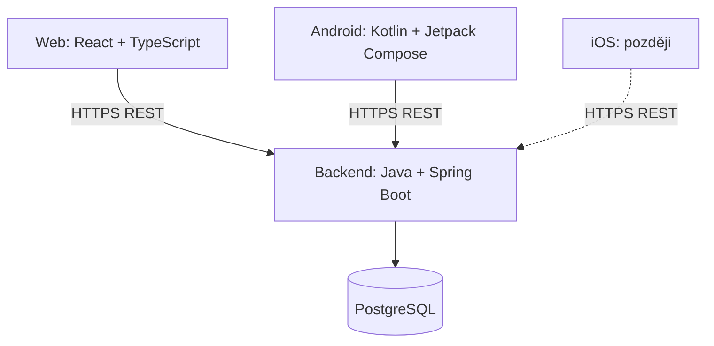

# 5P – Pohodová podzimní projížďka plná překvapení

Funkční specifikace systému pro organizaci etapových závodů

**Verze:** 0.9.0
**Datum:** 2026-10-28
**Stav:** Konsolidované potvrzené funkční požadavky; nepotvrzené návrhy a skutečně otevřené otázky jsou výslovně označeny. Dokument není potvrzením implementace budoucích konání.

Toto vydání přebírá nadále platná pravidla 0.8.0 a následně schválená pravidla šablon 4a–4d, Markdownu a knihovny souborů. Nahrazuje starší pravidla konání, změn trasy, restartů a hodnocení podle rozhodnutí z 28. 10. 2026. Pravidla nejsou paralelní varianty: přednost má toto vydání. Původní vydání zůstávají historická; rozpracovaná Rallye_specifikace.md není souběžnou závaznou specifikací.

Správa účtů, posádek a šablon existuje; správa konání a závodních průběhů zatím není implementovaná. Aktuální ověření implementace eviduje backend-plan.md. Skutečné HTTPS/Google/Apple ověření je oddělené od automatických simulovaných testů. Výjimky z potvrzených pravidel se nesmějí dovozovat z pracovního modelu ani orientačních URL.

## Historie verzí

| Verze | Datum | Změny |
|---|---|---|
| 0.9.0 | 2026-10-28 | READY snapshot včetně souborů; automatický/ruční start, řízená registrace a měnitelný společný konec; změny trasy/pravidel, individuální prominutí, restarty a obnova; pořadí podle hodnocených stanovišť, bez ručního rozhodování remíz; trvalá historie. Obnova dle aktuální trasy zůstává označená k rozhodnutí; GPS/CODE je potvrzené AND. |
| 0.8.0 | 2026-10-24 | D09 nahrazuje D04/D05: právě jedna neměnná LOCAL/GOOGLE/APPLE identita, bez link/unlink a dodatečného LOCAL. D10 nahrazuje D03: LOCAL heslo, externí relace s výslovným potvrzením; bez čerstvých grantů. |
| 0.7.0 | 2026-10-24 | Schválená rozhodnutí 3c-D01–D08: ověření externího e-mailu a dokončení registrace, čerstvé ověření, úplná správa nejvýše jedné identity každého typu, šifrovaný Apple revokační prostředek, HTTPS testovací prostředí a jednorázové mobilní předání s PKCE. |
| 0.6.0 | 2026-10-21 | Schválená pravidla 3b: posádky a fotografie, běžné i administrátorské převody, role ADMIN a bootstrap, rušení účtů, audit a jeho ruční úklid, Idempotency-Key. |
| 0.5.0 | 2026-10-21 | Samostatné účty a relace, ověření e-mailu a obnova hesla; více posádek, převody a historický název; textový seznam členů a počet dětí; přihlášky přes odkaz, startovací/náhradní kódy a zařízení; ruční remízy, publikace a veřejný archiv výsledků. |
| 0.4.0 | 2026-10-21 | Interní účet kapitána, více způsobů přihlášení a bezpečné propojení identit; členové výhradně u účasti, nezávislé kopie a uzamčení; výjimečné pozdní přihlášení; milisekundy, celé body a soutěžní pořadí; zrušení posledního stanoviště. |
| 0.3.4 | 2026-10-20 | Časová penalizace definována na úrovni stanoviště jako počet bodů za každou započatou jednotku (typicky sekundu či minutu); uzavřena související otevřená otázka. |
| 0.3.3 | 2026-10-20 | Zjednodušena statistika na medián od 5 vzorků; jednoduchý reset statistické verze při podstatné změně stanoviště; potvrzena platnost požadavku přijatého přesně v `end_at`; odstraněny uzavřené otázky. |
| 0.3.2 | 2026-10-20 | Předávání aktivačních kódů mimo aplikaci; přesná idempotence pokusů; přiměřená detekce falešné GPS; sdílené pořadí při úplné shodě; ručně nastavené maximum penalizace stanoviště. Uzavřené otázky odstraněny ze seznamu. |
| 0.3.1 | 2026-10-20 | Potvrzeno nahrazení již udělených penalizací stanoviště maximální penalizací při přeskočení či nedokončení; bez dvojího započtení. |
| 0.3.0 | 2026-10-20 | Jednotná penalizace přeskočení, příkaz v mobilu, přechod ze zrušeného stanoviště bez bodů a časů, vyloučení ze statistik, 5–6znakové kódy, soukromý charakter akcí. |
| 0.2.1 | 2026-10-20 | Příznak dítěte do 15 let je pouze deklarativní při zadávání jmen členů posádky; žádné ověřování věku ani ukládání data narození. |
| 0.2.0 | 2026-10-20 | Trvalé účty posádek, jednorázové aktivační kódy, hromadný start, pevný konec, penalizace nedokončených stanovišť, pořadí, operativní zásahy, GPS spoofing, statistika od 5 vzorků, minimalizace osobních údajů. |
| 0.1.0 | 2026-10-20 | První konsolidované vydání. Zahrnuje posádky jako účty, šablony a konání závodů, kopírování konfigurace, GPS/CODE, DELAYED, očekávané časy, historické robustní statistiky, dashboard a datové modely. |

**Pravidla verzování:** `MAJOR.MINOR.PATCH`. PATCH = upřesnění a opravy bez změny koncepce; MINOR = nové funkční požadavky nebo rozšíření modelu; MAJOR = zásadní změna koncepce. Každé vydání je samostatný soubor `Zavody_specifikace_vX.Y.Z.md`, předchozí vydání se nepřepisují. Změny se zapisují do historie verzí.

## 1. Cíl a rozsah

Uživatelské označení konkrétního konání závodu je **Akce**. Výraz „konání“ v popisu životního cyklu označuje stejnou Akci; interní názvy ani URL se nemění.

Systém slouží k vytváření opakovaně použitelných definic automobilových etapových závodů, pořádání konkrétních konání, registraci posádek, jejich vedení přes posloupnost stanovišť, evidenci pokusů a penalizací a sledování průběhu organizátorem. Zpočátku Android; později iOS. Správa přes web. Nízké provozní náklady; desítky až nižší stovky souběžných uživatelů.

## 2. Uživatelské účty, posádky a přihlášky

- **Uživatelský účet:** samostatný účet s neměnným interním ID, zobrazovaným jménem a kontaktním e-mailem; LOCAL používá e-mail i jako přihlašovací jméno, externí identitu určuje provider/issuer/subject.
- **Administrátor:** jediná administrativní role, která plní funkce organizátora i správce závodu.
- **Kapitán:** aktuální vlastník posádky. Jeden účet může vlastnit více posádek. Každá posádka má nejvýše jednoho aktuálního kapitána; posádky mohou existovat i bez kapitána.
- **Posádka:** trvalá evidence použitelná pro více konání, bez vlastních přihlašovacích údajů a bez trvalého seznamu členů. Členové účasti nejsou uživatelské účty.

### 2.1 Přihlášení, ověření a relace

Přihlášení e-mailem a heslem, Google nebo Sign in with Apple. Každý aktivní interní účet má právě jednu použitelnou přihlašovací identitu LOCAL, GOOGLE nebo APPLE, určenou při vytvoření účtu. Její typ ani konkrétní identitu nelze později změnit, nahradit, připojit další ani odpojit. K externímu účtu nelze dodatečně přidat místní heslo. Shoda e-mailu účty nikdy nepropojí. Z externích poskytovatelů přebírat pouze jméno, e-mail a nezbytný technický identifikátor identity, nikdy jejich hesla. Apple může poskytovat skrytou adresu a jméno nemusí při dalším přihlášení vrátit; chybějící jméno nesmí smazat již uložené.

Registrace uživatelského účtu e-mailem vyžaduje ověření adresy jednorázovým aktivačním odkazem zaslaným e-mailem. Tento odkaz neslouží k přihlášení posádky do závodu ani ke startu či převzetí rozehraného závodu. Neúspěšné přihlášení neprozradí, zda je chybně e-mail, nebo heslo. Žádost o obnovu hesla nesmí prozradit existenci účtu. Obnova používá jednorázový odkaz platný **30 minut**. Změna e-mailu vyžaduje opětovné ověření uživatele a potvrzení nové adresy; změna e-mailu nemění interní ID účtu.

Checkbox **„Zůstat přihlášený“** je standardně nezaškrtnutý. Současné přihlášení na více zařízeních je povolené. Změna hesla zneplatní ostatní relace, obnova hesla všechny relace. Bez zaškrtnutí přihlášení platí pouze po dobu aktuální relace aplikace nebo prohlížeče. Se zaškrtnutím může přetrvat až 30 dní a při používání se prodlužovat. Odhlášení okamžitě zneplatní příslušnou relaci na serveru; relace na různých zařízeních jsou nezávislé. Přihlášení do účtu není totéž co oprávnění konkrétního zařízení pokračovat v rozehraném závodě.

Historická účast uživatele vzniká vazbou na uživatele, který byl kapitánem posádky v okamžiku skutečného zahájení závodu. Pouhá přihláška historickou účastí není. Pozdější převod kapitána tuto vazbu původního kapitána nemění. Datový model ji musí trvale zachovat odděleně od aktuálního vlastníka posádky.

Při zrušení účtu bez historické účasti se účet trvale smaže; s historickou účastí se anonymizuje a výsledky se zachovají. Odstraní nebo anonymizují se osobní údaje samotného účtu, zejména e-mail, zobrazované jméno a přihlašovací identity; zneplatní se jeho relace a přihlašovací/tokenové prostředky. Automaticky se zruší všechny čekající převody, kde rušený uživatel vystupuje jako původní nebo cílový kapitán. Všechny posádky rušeného uživatele zůstanou zachované bez kapitána, i když nemají historickou účast.

Pokud je posádka pouze přihlášená do závodu, je zrušení účtu povoleno a přihláška zůstane zachována. Pokud právě závodí, zrušení účtu se nepovolí, dokud její účast neskončí. Po dokončení závodu se zrušení účtu řídí anonymizací kvůli historické účasti; rozhoduje trvalá historická vazba, nikoli pozdější vlastnictví. Posádka bez kapitána nemůže podat novou přihlášku, ale již existující přihláška se zrušením účtu neruší.

Historické posádky, názvy, výsledky a seznamy jmen členů v historických přihláškách pro interní evidenci a diplomy zůstávají zachované. Jména členů nejsou veřejná. Administrátor může zrušit účet podle stejných pravidel jako uživatel, bez obejití ochrany historie, běžící účasti či posledního administrátora. Zrušení převodů, odpojení kapitána, smazání/anonymizace a audit tvoří transakčně konzistentní operaci; při odmítnutí zrušení účtu se neprovedou částečné změny.

### 2.1.1 Externí přihlášení – schválená rozhodnutí 3c

Rozhodnutí 3c-D09 v tomto vydání nahrazuje D04 a D05 z 0.7.0, D10 nahrazuje D03; nejde o souběžně platné varianty. Jejich původní znění zůstává pouze v historickém vydání 0.7.0.

Následující pravidla doplňují 2.1 a mají přednost před staršími technickými návrhy. Neznamenají, že již existují příslušné endpointy nebo migrace.

- **3c-D01 – e-mail:** při první registraci přes Google/Apple je adresa ověřena pouze spolehlivým validovaným údajem poskytovatele. Jinak se vyžaduje vlastní ověření e-mailu. Shoda e-mailu nikdy automaticky nepropojuje účty; vlastní místní registrace nadále vyžaduje aktivační odkaz.
- **3c-D02 – dokončení registrace:** chybějící povinné jméno nebo použitelný e-mail doplní uživatel v samostatném kroku. Uživatelem doplněný e-mail se ověřuje vlastní cestou. Před dokončením registrace se nevydá plnohodnotná přihlašovací relace. Chybějící údaje poskytovatele při opakovaném přihlášení existující identity nepřepisují uložené hodnoty.
- **3c-D03 – nahrazeno D10:** původní požadavek externího čerstvého ověření a pětiminutových účelových oprávnění se pro zrušení účtu již nepoužije. Správa více identit odpadla podle D09.
- **3c-D04 – nahrazeno D09:** původní správa více způsobů, link/unlink a přidání LOCAL již nejsou povolené. Obnova hesla zůstává pouze pro již existující LOCAL identitu.
- **3c-D05 – nahrazeno D09:** původní limit jedné identity každého typu nahrazuje limit právě jedné identity celkem. Globální unikátnost (provider, issuer, subject) zůstává zachována.
- **3c-D09 – jediná neměnná identita:** právě jedna použitelná identita u každého aktivního účtu. LOCAL identita zachovává možnost změny a obnovy svého hesla; nejde o výměnu identity. Jméno a kontaktní e-mail jsou profilové údaje, jejich změna nesmí změnit identitu; tímto vydáním se nezavádí API změny e-mailu. Externí identitu určuje (provider, issuer, subject), nikoliv e-mail. Ztráta identity poskytovatele ani změna subjectu neopravňuje k automatickému převodu účtu. Při řádném zrušení se identita odstraní; anonymizovaný historický účet již přihlašovací identitu nemá. Nová registrace je nový účet bez původních práv.
- **3c-D10 – potvrzení vlastního zrušení:** u LOCAL je nutná platná relace a opětovné zadání a ověření aktuálního hesla. U GOOGLE/APPLE postačí platná autentizovaná relace a samostatné výslovné potvrzení uživatele. Externí auth_time, max_age ani nové přihlášení se nevyžadují. Potvrzení není novým ověřením identity, jde o vědomě přijatý bezpečnostní kompromis. Zachovávají se CSRF, audit, transakční konzistence, zneplatnění všech relací a další dosavadní ochrany. ADMIN cesta ověřuje jednajícího administrátora, ne heslo cíle; D10 jí nově neukládá čerstvou reautentizaci. Apple revokace při zrušení včetně administrátorského zůstává povinná podle D06, implementace v 3c.5.
- **3c-D06 – Apple revokace:** bezpečně uchovávat pouze nezbytný revokační prostředek, šifrovaně a s omezeným přístupem. Při zrušení účtu včetně administrátorského zajistit revokaci autorizace u Apple. Lokální databázová transakce je oddělená od externího volání; dočasný výpadek vede k bezpečnému opakování bez obnovy zrušeného účtu. Správa klíčů, retence a bezpečné odstranění prostředků musejí být součástí technického řešení. Nejde o ukládání tokenů do idempotentního ledgeru ani změnu jeho šifrování.
- **3c-D07 – ověření:** skutečné integrační ověření Apple používá samostatnou HTTPS testovací doménu. Nyní se nezřizuje doména ani infrastruktura. Automatické testy se simulovaným poskytovatelem se vykazují odděleně od skutečného ověření.
- **3c-D08 – mobil:** společný backendový OAuth2/OIDC authorization code tok přes systémový prohlížeč. Autorizační stav platí **10 minut**; mobil obdrží pouze jednorázový předávací kód platný **60 sekund** a vymění jej s **PKCE S256** za existující Rallye Bearer relaci. Jen explicitně konfigurované návratové adresy, Bearer nikdy v návratové URL. Expirace ani jednorázovost se opakováním neprodlužují.

Oprávnění, vlastnictví, historické vazby a ADMIN zůstávají navázané na neměnné interní ID. Externí přihlášení nemění pravidla 24hodinové/30denní nečinnosti, více relací, změny/resetu hesla a ochrany historie či posledního administrátora. Úplné zrušení ruší i nové přihlašovací kontexty; nezbytná chráněná práce na Apple revokaci může doběhnout po odstranění účtu, nesmí obnovit jeho data nebo práva.

### 2.2 Trvalá posádka a převod kapitána

Evidence posádky: ID, aktuální kapitán (může chybět), povinný název do **100 znaků**, nepovinná RZ do **32 znaků**, nepovinný popis do **2 000 znaků** a nepovinná fotografie vozidla. Jeden účet může vlastnit více posádek. Název ani RZ nemusí být unikátní. Název lze změnit; u konkrétního závodu se zachová název z okamžiku přihlášení. Posádka se může účastnit více konání, ale v jednom konání nejvýše jednou (unikátní `race_event_id + crew_id`). Posádku bez jakékoli účasti lze smazat, pokud nemá čekající převod; posádku s historickou účastí nelze smazat ani administrátorem. **Archivace posádek se nezavádí.**

Fotografie jsou pouze **JPEG/PNG**, nejvýše **5 MiB (5 242 880 bajtů)** a **4096 × 4096 pixelů** (každý rozměr nejvýše 4096 px). Ukládají se do soukromého souborového úložiště; nejsou veřejnými soubory a přístup musí být autorizovaný. Detaily bezpečného zpracování souborů jsou technickým návrhem v backend-plan.md.

Běžný uživatel zakládá posádku vždy se sebou jako kapitánem. Administrátor může založit posádku pro libovolného existujícího aktivního uživatele s ověřeným e-mailem nebo bez kapitána. Administrátor může existující posádce kapitána odebrat; běžný uživatel jej přímo odebrat nemůže.

Kapitán může zahájit převod zadáním e-mailu existujícího aktivního uživatele s ověřeným e-mailem. Převod na sebe sama není povolen; jeden uživatel může být kapitánem více posádek. Novému kapitánovi přijde jednorázový odkaz platný **7 dní**. Po přihlášení ke správnému účtu převod přijme nebo odmítne. Přijetí atomicky změní vlastníka: nový kapitán okamžitě získá oprávnění ke správě posádky včetně jejích účastí, původní tato správcovská oprávnění ztratí. Historické názvy ani výsledky se převodem nemění. Čekající žádost může zrušit původní kapitán. Během čekajícího převodu jsou úpravy posádky povoleny, její smazání je zakázáno. Převod je vázán na interní ID cílového účtu, nikoli na měnitelný e-mail; změna e-mailu nemění cílový účet žádosti. Na posádku může existovat nejvýše jedna aktivní žádost. Převody a jejich rozhodnutí se auditují. Převod kapitána nemění aktivní závodní zařízení: rozehraný závod pokračuje na dosavadním zařízení. Vlastnictví posádky a oprávnění zařízení k závodní účasti jsou oddělené. Změna závodního zařízení nadále vyžaduje náhradní startovací kód vydaný administrátorem.

Administrátor může kapitána změnit okamžitě bez potvrzení novým kapitánem. Cílem však musí být existující aktivní uživatel s ověřeným e-mailem a převod na sebe sama není povolen; výjimka se týká pouze potvrzení, nikoli podmínek cíle. Případný čekající převod se administrátorskou změnou nebo odebráním kapitána zruší; změna vlastníka, zrušení žádosti a audit musí být atomické. Ani tato změna nemění oprávnění aktuálního závodního zařízení.

### 2.3 Přístup ke konání a podání přihlášky

Plánované a probíhající závody nejsou veřejně nabízeny. Organizátor předává odkaz na konkrétní závod mimo aplikaci, například e-mailem. Přihlášku za svou posádku může podat každý registrovaný uživatel s odkazem, pokud splňuje pravidla registrace. Seznam povolených e-mailů se nezavádí. Odkaz nenahrazuje autentizaci ani jednorázový startovací kód. **Registraci posádky do závodu provádí přihlášený kapitán bez aktivačního kódu. Toto pravidlo neruší ověření e-mailu při registraci uživatelského účtu jednorázovým aktivačním odkazem.** Kódy pro start a výměnu zařízení jsou popsány v oddílu 4.7.

### 2.4 Členové konkrétní účasti

Přihláška obsahuje jedno víceřádkové textové pole: jeden člen na řádku. Při vytvoření se předvyplní zobrazované jméno kapitána, které lze libovolně změnit. Počet členů odpovídá počtu neprázdných řádků. Minimálně jeden člen; maximum se nastavuje v konfiguraci závodu, výchozí hodnota **5**.

Samostatné celočíselné pole `children_under_15` udává počet dětí mladších 15 let, které jsou již zahrnuté v seznamu. Musí být mezi nulou a počtem členů. Počet účastníků 15+ je počet členů minus `children_under_15`. Věk se deklaruje bez ověřování a bez data narození. **Samostatná tabulka členů, příznaky dítěte u jednotlivých jmen ani funkce změny pořadí členů se nezavádějí.**

Při nové přihlášce lze zkopírovat seznam z libovolné předchozí účasti téže posádky, včetně nedokončené. Vzniká nezávislá kopie, změny neovlivňují historii. Zda tlačítko přebírá i agregovaný počet dětí, je k upřesnění. Seznam a údaje rozhodné pro složení lze upravovat do oficiálního zahájení, pak se složení již přihlášených účastí uzamkne. Dřívější pravidlo pozdní účasti zůstává v platnosti: její složení se uzamkne při zařazení.

### 2.5 Otevření registrace a pozdní přihlášení

Registrace má volitelný časový interval a ruční otevření či uzavření. Ruční rozhodnutí má přednost před časovým plánem, dokud je organizátor nezruší; poté opět rozhoduje časový plán. Přesné hranice intervalu a výchozí chování bez intervalu zůstávají k rozhodnutí v kapitole 14.

Přihláška a start posádky jsou oddělené operace. Pozdní uplatnění startovacího kódu již přihlášené posádky je dovoleno podle pravidel startu a neposouvá společný end_at. Nové zadání nevymezuje, zda samotné otevření registrace po oficiálním startu současně nahrazuje dosavadní administrativní výjimku pozdního zařazení. Tato návaznost zůstává v kapitole 14; nesmí se svévolně povolit ani zakázat. Ukončené konání se znovu neotevírá.

### 2.6 Soukromý charakter a osobní údaje

Jde o soukromé neformální akce přátel, bez zvláštní administrativní agendy souhlasů pro veřejné akce. Plánovaná/probíhající konání nejsou veřejně nabízena, ale publikované definitivní výsledky a archiv minulých závodů jsou veřejné bez přihlášení. Veřejně se zobrazují názvy posádek z konkrétního závodu, nikoli jména členů.

Osobní údaje minimalizovat: jména, e-mail, nezbytné technické identifikátory přihlášení a RZ; chránit fotografie a popis vozidla. Nevyžadovat data narození, adresy, telefony ani účty členů. Interní zdůvodnění organizačních zásahů nesmí uniknout do veřejných výsledků.

### 2.7 Administrace, role a první administrátor

Administrátor má plná oprávnění ke správě posádek, včetně posádek bez kapitána, jejich údajů a soukromých fotografií. Může provést okamžitou změnu kapitána. Ani plná oprávnění neobcházejí zákaz smazání posádky s historickou účastí nebo během čekajícího převodu.

Administrátor může spravovat role **ADMIN jiných aktivních uživatelů**. Systém po zřízení prvního administrátora nesmí zůstat bez administrátora: odebrání role, zrušení účtu či jiné zneplatnění posledního aktivního administrátora musí být odmítnuto. Tato ochrana platí také při souběžných požadavcích a při zrušení účtu samotným uživatelem. Pravidla případné změny vlastní role nejsou tímto rozhodnutím rozšířena.

První administrátor vznikne jednorázovým SQL bootstrapem konkrétního existujícího aktivního účtu. **Veřejné bootstrap API se nezavádí**, role se neuděluje registrací ani automaticky při startu aplikace. Administrátorské zásahy včetně bootstrapu, správy rolí, změn kapitána a rušení účtů se auditují. Dokončený CSV export má best-effort audit podle 13.1.

## 3. Šablona a Akce

### 3.1 Šablona a připravenost

Šablona je opakovaně použitelná definice lineárně seřazených stanovišť. Každý ADMIN může spravovat všechny šablony. Nová šablona je DRAFT a může obsahovat neúplná stanoviště. READY vyžaduje alespoň jedno kompletní stanoviště a úplné odkazy ve všech instrukcích i přiložených Markdown dokumentech. Neúplné zapnuté ověřování nelze obejít jinou kompletní kontrolou; otázka kombinace GPS/CODE je v 4.1.

Stanoviště obsahuje název, očekávanou dobu, instrukce a potřebnou konfiguraci. max_penalty_points je nepovinné nezáporné celé číslo; při nevyplnění znamená 0 a nebrání READY. Je to náhradní penalizace při přeskočení/nedokončení, nikoli průběžný strop. Ostatní bodové sazby mohou být záporné, nulové i kladné. Podstatné změny stanovišť, pořadí a společné penalizace vracejí READY do DRAFT; změna názvu či popisu šablony nikoliv. Skutečný no-op nemění verzi ani stav. Šablony a stanoviště lze duplikovat. Použitou šablonu nelze smazat.

### 3.2 Markdown a knihovna souborů

Jediným zdrojem instrukcí je Markdown; HTML je bezpečně odvozený obsah, nikoli druhý editovatelný zdroj. Instrukce mají limit 100 KiB UTF-8. Soukromá knihovna podporuje JPEG/PNG (5 MiB, nejvýše 4096 × 4096 px), Markdown dokumenty (1 MiB UTF-8) a PDF (50 MiB). Soubory mají normalizované původní názvy v jednom prostoru bez rozlišování velikosti písmen; nepřepisují se ani nepřejmenovávají. Odkazy mohou být relativní nebo explicitní na příslušnou knihovnu. Soubor používaný instrukcemi nebo jiným dokumentem nelze odstranit; samotný odkaz souboru na sebe jeho odstranění neblokuje.

V DRAFT jsou dopředné odkazy dovoleny: vracejí upozornění a chybějící cíl skutečné 404. READY chybějící cíle nedovoluje. Cykly mezi Markdown dokumenty jsou povolené, bez rekurzivního vkládání. PDF se poskytuje jako bezpečná příloha ke stažení. Přesný již schválený kontrakt šablonového API zůstává v template-files.md; tato konsolidace jej nemění.

### 3.3 Nezávislá Akce

Z jedné šablony lze vytvořit více konání. Konání vzniká **pouze z READY šablony**. Při vytvoření se pořídí nezávislý snapshot všech stanovišť, jejich pořadí, pravidel, instrukcí a knihovny souborů včetně přiložených dokumentů a jejich odkazů. Pozdější změny šablony nesmějí existující konání ovlivnit. Konání nesmí kvůli čtení svého obsahu záviset na aktuálním obsahu zdrojové šablony.

Zdrojové identifikátory lze zachovat pro původ a budoucí statistiky, nikoli jako živou konfiguraci. Statistické verze se nezavádějí (schválená změna 4b). Během konání se uplatní výhradně změny jeho vlastní konfigurace podle 7.3. Po skončení jsou trasa a pravidla neměnné.

## 4. Model závodu a průchod stanovišti

Stanoviště jsou **lineární, uspořádaná posloupnost**. Po dokončení aktuálního se aktivuje další; po posledním se dokončí závod. Mobilní aplikace zobrazí instrukce/obsah (například HTML). Posádka postupuje nezávisle na ostatních.

Konání podporuje **automatický i ruční oficiální start**. Server zaznamená jediný autoritativní okamžik zahájení; souběh plánovaného a ručního startu nesmí závod zahájit dvakrát. Přesná pravidla souběhu a ručního startu oproti plánovanému času budou součástí technického návrhu, případné funkční nejasnosti jsou v kapitole 14.

Všechny posádky mají společný **end_at**. Organizátor jej může během běžícího konání prodloužit i zkrátit, ale nový čas musí být v budoucnosti. Změna se audituje a zachová v závodní historii. Pozdní start posádky neposkytuje časovou kompenzaci. Po skončení se konání znovu neotevírá.

Odpověď přijatá serverem přesně v end_at je platná (`received_at <= end_at`), pozdější nová odpověď nikoliv. Opakování již přijatého idempotentního požadavku vrací původní výsledek bez nové změny. Uzávěrku musí server vynutit i při výpadku plánovače; technické pořadí včas přijatého požadavku a finalizace nesmí změnit funkční hranici. Nedokončená stanoviště se vyhodnotí podle kapitoly 7.

Oficiální zahájení konání a individuální start posádky kódem jsou odlišné operace. Aktivací stanoviště začíná měření doby. Úspěšný pokus stanoviště dokončí a zastaví čas. Neúspěšný pokus může přidat penalizaci, ale stanoviště zůstává aktivní a čas pokračuje. Autoritou pro rozhodnutí, časy a body je backend. Závodní posádka obvykle sestává z řidiče a spolujezdce; mobil může během jízdy obsluhovat spolujezdec, interakce během přesunu není obecně zakázána.

### 4.1 Způsoby dokončení

- **GPS:** ověření polohy v nastaveném perimetru.
- **CODE:** zadání správného kódu.
- **QUIZ:** plánované rozšíření; otázky, odpovědi a pravidla dokončení zatím nejsou definitivní.

**Závazné rozhodnutí GPS/CODE:** pouze CODE vyžaduje CODE, pouze GPS vyžaduje GPS; při definování obou musí být splněny **obě podmínky (AND)**. Nejde o otevřenou otázku ani volitelný režim OR. Časová pravidla zůstávají nezávislá. Současná konfigurace StageConfiguration, validace TemplateReadiness a testy tomuto rozhodnutí odpovídají; tato oprava nemění jejich produkční chování. Samotné závodní vyhodnocování se doplní v etapě průběhu.

### 4.2 GPS

Stanoviště má souřadnice `latitude`, `longitude`, akceptační poloměr `radius_m` a pevnou penalizaci za neúspěšné ověření mimo perimetr.

- **Bez průběžného nebo background GPS sledování.** Posádka stiskne **Ověřit polohu**; mobil jednorázově získá souřadnice a přesnost a odešle je serveru.
- Server spočítá vzdálenost (např. Haversine) a rozhodne o přijetí.
- **Uvnitř perimetru:** úspěch GPS kontroly. U samostatného GPS dokončí stanoviště a zastaví časování i před minimální dobou; u kombinace s CODE dokončí stanoviště až úspěch obou kontrol.
- **Mimo perimetr:** pevná penalizace; stanoviště není dokončeno a čas pokračuje.
- **Přesnost GPS horší než perimetr (`accuracy_m > radius_m`):** pouze hlášení, poloha se nepoužije, bez penalizace za chybnou polohu. Nedostupná poloha je také technická chyba bez penalizace.
- **Detekovaný aktivní systém falešných souřadnic:** polohu nepoužít, zaznamenat bezpečnostní událost k účasti posádky na serveru, informovat posádku a přidělit nastavenou penalizaci za podvržení. Cílem je odhalit běžné způsoby podvržení, nikoli zaručit úplnou ochranu. Na Androidu se použijí dostupné signály mock-location; na iOS se použijí dostupné platformní prostředky, pokud to bude technicky možné. Neodhalené sofistikované podvržení nelze vyloučit.
- Evidovat každý pokus, čas serveru, polohu, deklarovanou přesnost, vypočtenou vzdálenost, výsledek a případné body. Ochrana proti duplicitám a zpoždění sítě je povinná; detekce podvržení má výše uvedenou reakci.
- Mapa organizátora ukazuje **poslední potvrzené stanoviště**, nikoliv aktuální pohyb posádky.

### 4.3 CODE

Server ověřuje zadaný kód. Správný kód znamená úspěch CODE kontroly; u samostatného CODE dokončí stanoviště a zastaví čas, u kombinace musí být splněna také GPS kontrola. Chybný kód přidá nastavené trestné body a stanoviště zůstává aktivní. Správný kód se neposkytuje účastnickému klientovi. ADMIN jej může číst a upravovat jako běžnou konfiguraci, v normalizované otevřené podobě (krajní mezery se odstraní, velká písmena bez závislosti na locale, 1–128 znaků). CODE se neukládá do auditu, idempotentních záznamů ani běžných logů. Hashování hesel a autentizačních tokenů zůstává beze změny.

### 4.4 Časové penalizace

Každé stanoviště může mít v definici volitelnou **časovou penalizaci**. Organizátor nastaví délku penalizačního intervalu (typicky **1 sekunda** nebo **1 minuta**, případně jiná kladná délka v sekundách) a počet trestných bodů za **každý započatý interval**.

`time_penalty_points = ceilDiv(actual_duration_ms, penalty_interval_ms) * points_per_interval`

Například při sazbě 3 body za každou započatou minutu a době plnění 125 sekund vzniká penalizace `ceil(125/60) * 3 = 9` bodů. Při nulové době je penalizace nulová. Výpočet probíhá při dokončení stanoviště z autoritativních serverových časů a přičítá se k ostatním platným penalizacím stanoviště; pravidla nahrazení penalizací při přeskočení/nedokončení a pravidla zrušení stanoviště mají přednost. Konfigurace se kopíruje ze šablony do konkrétního konání.

### 4.5 DELAYED – penalizace předčasného dokončení

`DELAYED` **není způsob dokončení ani časová brána**; je to časové pravidlo. Stanoviště se dokončí okamžitě při splnění platné podmínky dokončení (u kombinovaného GPS/CODE obou kontrol), i před uplynutím minimální doby. Předčasnost se pouze penalizuje za každou započatou sekundu:

`early_ms = max(0, minimum_duration_ms - actual_duration_ms)`

`early_penalty = ceilDiv(early_ms, 1000) * early_penalty_per_second`

Příklad: minimum 900 s, skutečnost 720 s, sazba 2 body/s => 360 bodů. Pokus GPS mimo perimetr stanoviště nedokončí, a proto sám o sobě nevyvolá penalizaci za předčasné dokončení.

### 4.6 Přesnost a celočíselný výpočet

Časové okamžiky i doby se evidují s přesností na milisekundy; autoritou je server v UTC. Trestné body jsou celá čísla. `ceilDiv(a, b)` znamená celočíselný podíl zaokrouhlený nahoru pro nezáporné `a` a kladné `b`; při `a = 0` je výsledek nula. Délka penalizačního intervalu se při výpočtu převede na milisekundy. Nezaokrouhlovat dobu před odečtením nebo před určením počtu intervalů. Implementace musí kontrolovat rozsah při násobení, nepoužívat výpočty bodů v plovoucí čárce.

Příklady při sazbě 3 body za započatou minutu: 0 ms = 0 bodů, 60 000 ms = 3 body, 60 001 ms = 6 bodů, 125 000 ms = 9 bodů. DELAYED při minimu 900 000 ms a sazbě 2 body za započatou sekundu: doba 900 000 ms = 0 bodů, 899 999 ms = 2 body, 898 999 ms = 4 body, 720 000 ms = 360 bodů. Výpočet zpřesňuje dřívější sekundový vzorec při zachování celých bodů.

### 4.7 Startovací kódy a výměna zařízení

Každá posádka dostává vlastní jednorázový startovací kód pro účast v konkrétním konání od organizátora mimo aplikaci. Zadání před oficiálním zahájením pouze zobrazí upozornění, kód zůstává použitelný. Úspěšné uplatnění je atomické a jednorázové. Při úspěšném použití původního startovacího kódu se zaznamená individuální čas startu posádky. Slouží především ke statistickému vyhodnocení skutečné doby absolvování a zpřesňování časových odhadů. Pozdní start neposouvá aktuálně platný společný konec `end_at` a neposkytuje časovou kompenzaci. Použití náhradního kódu tento původní individuální čas startu nikdy nepřepíše.

Administrátor může opakovaně vydat náhradní jednorázový startovací kód pro pokračování existujícího rozehraného závodu na jiném zařízení. Vždy existuje nejvýše jeden platný nepoužitý náhradní kód; nové vydání musí respektovat tento limit. **Vydání původní zařízení neodpojí; až úspěšné použití náhradního kódu zneplatní oprávnění původního zařízení.** Stav závodu, průchod a historie se zachovají. Více současných přihlášení do uživatelského účtu tím není zakázáno; mění se oprávnění závodního zařízení pro danou účast.

Kódy nemají samostatnou časovou expiraci; společná uzávěrka závodu se tím neobchází. Dosavadní formát kódů zůstává 5–6 znaků z 0–9 a A–Z, se základní ochranou proti hádání a bezpečným uložením na serveru. Správné kódy se neposkytují běžnému klientovi; předání organizátorem probíhá mimo aplikaci. Administrátor může sledovat stav volný/použitý/nahrazený; spotřebovaný kód se automaticky znovu nepoužije.

Při vydání náhradního kódu může administrátor zadat libovolnou celočíselnou bodovou úpravu: kladnou, nulovou nebo zápornou. **Automatická penalizace za výměnu zařízení neexistuje.** Vydání, použití, zneplatnění oprávnění a bodová úprava se auditují. Bodová úprava se započte až při úspěšném použití náhradního startovacího kódu, právě jednou a atomicky s převodem závodního oprávnění na nové zařízení. Nepoužitý kód hodnocení neovlivní; při zneplatnění nepoužitého kódu se žádná úprava neprovede. Tyto úpravy nelze zaměnit s penalizací konkrétního stanoviště.

## 5. Terminologie a časy

**Závazná terminologie:**

| Název | Význam |
|---|---|
| Čas dokončení stanoviště | Skutečný zaznamenaný časový okamžik dokončení stanoviště |
| Očekávaný čas dokončení stanoviště | Vypočítaný předpokládaný okamžik dokončení stanoviště |
| Čas dokončení závodu | Skutečný zaznamenaný časový okamžik dokončení závodu |
| Očekávaný čas dokončení závodu | Vypočítaný předpokládaný okamžik dokončení závodu |
| Doba plnění stanoviště | Interval od aktivace do dokončení stanoviště |
| Celková doba závodu | Skutečná doba absolvování posádkou od jejího individuálního startu (úspěšné použití původního startovacího kódu) do dokončení; individuální start nemění společný end_at |

**Bez přívlastku „očekávaný“ jde vždy o skutečný čas, nikoliv odhad.**

Pro aktuální stanoviště `k`, čas aktivace `A_k` a odhad doby `D_i`:

- Očekávaný čas dokončení aktuálního stanoviště: `A_k + D_k`.
- Očekávaný čas dokončení závodu: `A_k + sum(D_i, i=k..n)`.

Pokud očekávaný okamžik již uplynul, zobrazí se zpoždění vůči odhadu. Odhady nejsou základem pro trestné body nebo průběžné pořadí.

## 6. Historické statistiky očekávaných dob

Každé stanoviště šablony má organizátorem zadanou **výchozí očekávanou dobu plnění**. Skutečné doby dokončených průchodů **nezrušených stanovišť** z **předchozích i právě probíhajícího konání** se standardně zahrnují do statistiky pro průběžné výpočty a exporty i pro budoucí konání. Výpočet používá stejnou metodiku bez ohledu na konání.

Pro statistiku vybírat **jednotlivé skutečné doby** dokončených průchodů, nikoli průměry jednotlivých konání. Zrušená stanoviště, dobrovolně přeskočené a nedokončené průchody se do statistik nezahrnují. Organizační prominutí není skutečným dokončením a nevytváří statistický vzorek doby plnění.

**Jednoduchý algoritmus očekávané doby:**

1. Pokud jsou k dispozici **méně než 5 platných dokončení**, použít organizátorem ručně zadanou očekávanou dobu stanoviště.
2. Od **5 platných dokončení včetně** použít **medián** skutečných dob. Medián je odolný proti jednotlivým extrémům; žádné dodatečné vyřazování pomocí MAD ani test stability se nezavádí.
3. Započítávají se také platná dokončení z **právě probíhajícího konání**, takže odhad se může průběžně měnit. Odhad je pouze informativní a neovlivňuje body ani pořadí.
4. Všechny skutečné doby se zachovávají v historii, nic se kvůli odhadu nemaže.

**Změna stanoviště:** schválená etapa 4b odstranila statistické verze a reset statistiky změnou statistics_version. Historické skutečné doby příslušného stanoviště zůstávají zachované. Technická verze šablony ani revize trasy nejsou statistickou verzí. Způsob výběru vzorků při restartech a obnovení průběhů zůstává k upřesnění v kapitole 14.

Pro zobrazení postačí `sample_count`, `median_duration_ms` (pokud existuje) a `expected_duration_ms` (efektivní odhad). Výpočet lze provádět z databáze nebo jednoduchou cache.

## 7. Penalizace, ukončení a konečné pořadí

Každá penalizace je samostatný záznam `penalty_event` s typem, body, zdrojem a důvodem. Kategorie zahrnují GPS mimo perimetr, chybný kód, předčasné dokončení, časovou penalizaci, GPS spoofing, kvíz (pravidla zatím otevřená), přeskočení/nedokončení a případné auditované korekce. Součet aktivních penalizací a platných samostatných bodových úprav určuje skóre posádky. Bodová úprava při náhradním kódu může být i záporná; žádná automatická penalizace za výměnu zařízení nevzniká.

### 7.1 Přeskočená a nedokončená stanoviště

**Konfigurace:** `race_template.skip_penalty_points` je společná hodnota pro celý závod, zkopírovaná do `race_event`. Každé stanoviště má svou náhradní penalizaci (nevyplněná znamená 0), nikoli průběžný strop; jejich součet se zobrazí před přeskočením.

- Posádka nemusí absolvovat všechna stanoviště.
- Mobilní aplikace poskytne příkaz **„Přeskočit stanoviště“**. Před potvrzením zobrazí **celkovou penalizaci** (maximum stanoviště + jednotná penalizace závodu). Po potvrzení se stanoviště přeskočí a aktivuje následující. Posádka se nesmí zaseknout na jediném stanovišti.
- Za **přeskočené stanoviště posádkou** se přidělí **maximální možná bodová penalizace konkrétního stanoviště + jednotná penalizace za přeskočení**. **Dosavadní penalizace získané na tomto stanovišti se touto výslednou penalizací nahrazují, nepřičítají se k ní.** Původní události zůstávají v auditní historii, ale nevstupují do aktivního bodového součtu. Jednotná penalizace se nastaví pouze jednou v konfiguraci šablony závodu a kopíruje se do konání.
- Při dosažení aktuálně platného end_at konání se obdobně penalizují **všechna nedokončená stanoviště**, včetně právě aktivního. Aktivované, ale nesplněné stanoviště je stále nedokončené.
- **Maximální bodová penalizace každého stanoviště se zadává ručně v definici stanoviště** (`template_stage.max_penalty_points`) a kopíruje do konání. Je to autoritativní hodnota pro přeskočení či nedokončení, nezávislá na počtu pokusů a délce trvání. Není nutné ji dopočítávat z dílčích pravidel.
- Penalizace za nedokončení se přidělí právě jednou, transakčně a idempotentně. **Také při nedokončení z důvodu konce závodu nahrazuje výsledná penalizace dosavadní penalizace konkrétního stanoviště**; původní události zůstávají auditovatelné, ale nejsou znovu započítány.
- **Zrušení stanoviště organizátorem** je odlišné od přeskočení posádkou a **nesmí být penalizováno** (viz 7.3).

### 7.2 Pořadí a publikování výsledků

Pořadí se určuje postupně:

1. Vyšší počet hodnocených stanovišť: skutečně splněná + organizačně prominutá.
2. Nižší celkový počet trestných bodů.
3. Nižší počet účastníků ve věku 15 let a více (neprázdné řádky members_text minus children_under_15).
4. Při úplné shodě společné umístění, např. **1, 2, 2, 4**.

Přeskočená, globálně zrušená a nesplněná stanoviště se do hodnoceného počtu nezapočítávají. **Ruční rozhodování úplných remíz se nezavádí.** Starší tie_decision je překonané pravidlo, nikoli volitelná administrativní funkce.

Součet účinných penalizací stanovišť a samostatných podepsaných korekcí může být záporný; nepoužije se minimum nula. Náhradní penalizace při přeskočení/nedokončení nadále nahrazuje dosavadní účinné penalizace daného stanoviště, nikoli historii jejich vzniku.

Průběžné pracovní pořadí vidí **pouze organizátor/ADMIN**. Účastníci výsledky vidí až po definitivním zveřejnění. Vlastní provozní stav a historie účasti tím nejsou zakázány.

Po end_at server vyhodnotí neabsolvovaná stanoviště právě jednou. Nedokončená posádka nemá čas dokončení závodu; completed_at zůstane prázdný, eviduje se čas ukončení účasti. Dokončení a administrativní či časové ukončení nejsou zaměnitelné.

Po skončení lze opravovat bodové hodnocení a odvolávat individuální prominutí, ale nikoliv měnit trasu a pravidla. Definitivní výsledky zveřejňuje ručně organizátor. Lze je stáhnout z veřejného zobrazení, opravit a znovu zveřejnit. Historické verze se zachovají; stažení není smazáním historie. Dostupnost starších verzí veřejnosti je otevřená otázka.

Publikované výsledky a veřejný archiv používají názvy posádek zachované při přihlášení, nikdy jména členů či interní důvody organizačních zásahů. Změna názvu, kapitána ani zrušení účtu nesmí přepsat historii výsledků.

### 7.3 Změny trasy a pravidel během konání

Během běžícího konání organizátor může přidávat stanoviště, měnit jejich pořadí, upravovat instrukce i pravidla a rušit stanoviště. Při změně trasy musí rozhodnout, zda se změna vztahuje také na posádky, které již dotčenou část projely. Rozsah dopadu se výslovně zaznamená; nesmí se odvodit náhodně podle pořadí souběžných požadavků. Dokončené posádky nejsou následnými změnami trasy automaticky ovlivněny.

Změny pravidel platí okamžitě pro posádky, které stanoviště dosud nedokončily. Výsledky již dokončených stanovišť se automaticky nepřepočítávají. Původní pravidla, pokusy a výsledky zůstávají v trvalé závodní historii. Konkrétní dopad na běžící měření a již splněnou dílčí GPS/CODE kontrolu je otázka 14.

Při **globálním zrušení stanoviště** organizátor rozhodne, zda dosavadní penalizace zachová, nebo odstraní z účinného hodnocení. Původní události se nikdy nemažou. Zrušené stanoviště se nezapočítává mezi hodnocená a nevytváří platné statistické vzorky. Zrušení není přeskočení posádkou a samo o sobě neuděluje penalizaci za přeskočení. Rozsah rozhodnutí vůči záporným sazbám a již dokončeným průběhům je výslovně k dořešení v kapitole 14.

Na zrušeném stanovišti se zobrazí instrukce pro pokračování a tlačítko „Zobrazit další stanoviště“, kterým se aktivuje další stanoviště a jeho měření. Dosavadní pravidlo automatického dokončení při zrušení posledního zbývajícího stanoviště zůstává; přesný čas tohoto přechodu je nadále otevřený.

### 7.4 Individuální prominutí a bodové zásahy

Organizátor může konkrétní stanoviště konkrétní posádce prominout. Prominuté stanoviště se do počtu hodnocených započítá jako splněné, ale historie jej musí odlišit od skutečného splnění. Prominutí i jeho odvolání vyžadují zdůvodnění a audit. Odvolání obnoví předchozí stav a původní účinné penalizace. Je povolené i po skončení konání; nesmí tím znovu otevřít konání ani povolit opožděné odpovědi.

Organizátor může opravovat penalizace konkrétního stanoviště a přidávat samostatnou kladnou či zápornou korekci posádky. Oprava nezničí původní závodní historii. Vztah následných oprav, změn pravidel a odvolání prominutí vyžaduje dořešení podle 14; konsolidace nevymýšlí prioritu konfliktních zásahů.

### 7.5 Restart a obnova průběhu

Organizátor může posádku **neomezeněkrát restartovat před end_at**, včetně již dokončené posádky. Každý restart vytvoří nový samostatný průběh. Starší průběhy se archivují, nikoliv mažou. V rámci účasti má posádka právě jeden aktuální průběh; dokončený průběh může být aktuální a není tím automaticky archivovaný.

Při restartu se v novém průběhu vynulují penalizace stanovišť a individuální prominutí. Organizátor rozhodne, zda zachovat samostatné celkové bodové korekce. Archivovaný původní průběh včetně svých penalizací a prominutí se nepřepisuje.

Před end_at může organizátor obnovit libovolný archivovaný průběh, i když již posádka pokračovala v novém. Každý restart i obnova vyžadují zdůvodnění a audit. Nový start konání tím nevzniká a společný konec se automaticky neposouvá.

**Nepotvrzené navržené výchozí řešení:** obnovený průběh pokračuje od svého původního místa podle aktuální trasy a zachová dokončená stanoviště. Toto pravidlo nebylo samostatně potvrzeno a závislé chování nelze implementovat bez rozhodnutí. Zejména řešení nově vložených/zrušených stanovišť a měření času zůstává otevřené.

Každá operace posádky musí být svázána s konkrétním průběhem a **generací jeho aktivace**. Opožděný požadavek nesmí změnit neaktivní průběh ani předchozí generaci, a to ani po obnovení téhož průběhu. Opakování již vyřízeného idempotentního požadavku může vrátit původní výsledek, nikdy znovu provést změnu.

## 8. Webový dashboard organizátora

Zobrazuje mapu stanovišť, poslední potvrzené dokončené stanoviště každé posádky (nikoliv průběžnou polohu), a tabulku:

- posádka a stav;
- poslední dokončené a aktuální stanoviště;
- poslední aktivita;
- dosavadní trestné body;
- **očekávaný čas dokončení aktuálního stanoviště**;
- **očekávaný čas dokončení závodu**;
- případné zpoždění proti odhadu.

Po kliknutí na posádku lze zobrazit průchod, historii pokusů a penalizací. Stanoviště mohou na mapě agregovat počet posádek. Průběžné výsledky a pořadí jsou dostupné pouze administrátorovi; veřejně až ručně publikované definitivní výsledky.

### 8.1 Aktualizace dashboardu

Uživatel nastavuje interval automatické aktualizace. **Potvrzené hodnoty:** 5, 10, 15, 30 nebo 60 sekund; výchozí 10 sekund. Lze vypnout automatické aktualizace a obnovovat ručně. Volba se uchovává pro uživatele; dashboard zobrazuje čas poslední úspěšné aktualizace. V první verzi REST polling; SSE/WebSocket pouze případné pozdější rozšíření.

## 9. Mobilní aplikace

Samostatný účet s e-mailem a heslem, Google/Apple a volbou Zůstat přihlášený; správa více posádek a jejich převodů; přístup ke konání přes odkaz a podání přihlášky; víceřádkový seznam členů, počet dětí a kopie z libovolné předchozí účasti včetně nedokončené. Start jednorázovým kódem až po automatickém nebo ručním oficiálním zahájení; pokračování náhradním kódem na jiném zařízení se zneplatněním původního závodního oprávnění.

Zůstává dobrovolné přeskočení s náhledem penalizace, pokračování ze zrušeného stanoviště bez bodů a časů, aktuální instrukce a měření doby, jednorázové GPS ověření, CODE a později kvíz, výsledek vlastního pokusu, penalizace, historie a dokončení. Vlastní provozní stav účasti není veřejným průběžným pořadím. Definitivní publikované výsledky a veřejný archiv lze číst bez přihlášení. GPS na pozadí není požadována; offline dokončování není stanoveno, první návrh počítá s připojením pro ověřování.

## 10. Funkční objekty a historické vazby

Tato kapitola popisuje odpovědnosti, nikoliv závazný návrh SQL tabulek. Stav implementace a konkrétní API jsou oddělené od budoucích funkcí.

| Objekt | Význam |
|---|---|
| Účet a identita | Interní neměnné ID, právě jedna LOCAL/GOOGLE/APPLE identita, relace a pravidla rušení podle 2.1. |
| Posádka | Trvalá evidence s aktuálním kapitánem; bez trvalého seznamu členů. |
| Šablona a stanoviště | Opakovaně použitelná definice, konfigurace a soukromá knihovna souborů, DRAFT/READY. |
| Konání | Nezávislý READY snapshot, registrace, automatický/ruční start, společný end_at a ukončení. |
| Přihláška/účast | Jedinečná vazba konání+posádka, historický název, členové a počet dětí, trvalá historická vazba kapitána. Registrace není start. |
| Průběh posádky | Jeden samostatný pokus o absolvování trasy; více archivovaných, právě jeden aktuální v rámci účasti. |
| Aktivace průběhu | Generace oprávněného zpracování požadavků; restart/obnova nesmějí oživit staré požadavky. |
| Průchod stanovištěm a pokus | Aktivace, skutečný výsledek, použité podmínky, časy a trvalá idempotence; oddělené od původní definice šablony. |
| Závodní zařízení a kódy | Oprávnění pokračovat v konkrétní účasti, oddělené od relace a kapitánství; startovací a náhradní kódy dle 4.7. |
| Penalizace, korekce, prominutí | Účinné bodové události a změny bez mazání původní historie, podepsané body. |
| Revize trasy a pravidel | Změna, aktér, rozsah dotčených průběhů a původní obsah; trvalá historie nezávislá na bezpečnostním auditu. |
| Publikace výsledků | Historické verze pořadí a názvů, zveřejnění a stažení; veřejná data bez členů. |

**Technický návrh stavů, nikoliv další funkční rozhodnutí:** konání PLANNED/RUNNING/ENDED; registrace řízená samostatně; průběh NOT_STARTED/RUNNING/COMPLETED/ENDED, aktuálnost vyjádřená odděleně. completed_at znamená skutečné dokončení, ended_at ukončení účasti; jejich záměna není dovolena. Stavový automat prominutí a jeho odvolání bude navržen po vyřešení 14.

Historické účasti, průběhy, výsledky a potřebné zdrojové vazby musí přežít oprávněné rušení účtů. Posádky s historickou účastí a použité šablony nelze smazat. Pouhá registrace ani změna aktuálního kapitána nesmějí svévolně měnit historickou vazbu. Ochrany a souběh je nutné zavést před prvním zápisem skutečných účastí.

## 11. REST API a oprávnění

Konkrétní existující kontrakty autentizace, posádek a šablon zůstávají zachované; nová specifikace je nemění. Dokumentace existujících API: authentication-2a.md, own-profile.md, crews-3b2.md, account-cancellation-3c3b.md a template-files.md. Profil používá GET/PATCH /api/v1/auth/me; vlastní rušení POST /api/v1/auth/account-cancellations. Šablony se upravují PUT, nikoli starším orientačním PATCH. Změna e-mailu nemá tímto vydáním schválený implementační rozsah.

Budoucí API musí pokrýt správu konání a jeho snapshotu, registraci a členy, řízení startu/konce, závodní zařízení, průběhy a pokusy, změny trasy/pravidel, prominutí, restarty/obnovu, hodnocení a publikace. Přesné URL, DTO a chyby se schválí technickým návrhem; nevzniká endpoint pro ruční rozhodování remíz. Každá měnící účastnická operace obsahuje vazbu na průběh a generaci aktivace.

Organizační operace a pracovní pořadí jsou pouze pro aktuální ADMIN. Přihlášku spravuje oprávněný kapitán, závodní operace navíc respektují závodní oprávnění zařízení. Přístup k souborům konání má **samostatnou účastnickou autorizaci**; nesmí se obejít zpřístupněním šablonové ADMIN knihovny. Rozsah dostupnosti budoucích stanovišť/souborů je otevřený v 14. Veřejné čtení výsledků poskytne jen právě zveřejněná data v rozsahu schválené publikace.

Webové měnící operace nadále respektují CSRF a cookies, mobilní existující Bearer relace. Backend vynucuje oprávnění podle aktuálního stavu databáze, nikoli jen podle údajů při přihlášení.

## 12. Architektura a technologie

- **Backend:** Java 21, Spring Boot 4.1.1, embedded Tomcat, Spring Security, Spring JDBC/JdbcTemplate, Flyway. Závislost JPA/Hibernate v projektu zůstává, ale existující funkční moduly nepoužívají JPA entity; OpenAPI není tímto tvrzeno jako implementované.
- **Web:** React + TypeScript; mapa Leaflet nebo MapLibre.
- **Android:** Kotlin + Jetpack Compose; jednorázové GPS přes platformní lokalizační API.
- **Databáze:** PostgreSQL; JSONB pro typově specifická pravidla; PostGIS není při předpokládaném zatížení nezbytný.
- **Provoz:** jednoduchý modulární monolit, Docker Compose na levném VPS nebo vhodné free-tier infrastruktuře. Bez potřeby mikroslužeb či Kubernetes.
- **CI/CD:** návrh GitHub Actions; zálohy DB mimo provozní server.

## 13. Spolehlivost, bezpečnost a audit

**Bezpečnostní audit není trvalá závodní historie.** Průběhy, pokusy, revize trasy/pravidel, penalizace, prominutí, jejich odvolání a verze publikací nesmějí záviset pouze na audit_event s retencí. Restart a změna účinnosti neodstraňují původní záznamy. Organizační zásah a jeho závodní důsledky jsou transakčně konzistentní, včetně auditu. Uchovávání závodní historie tato konsolidace nepodřizuje 365dennímu bezpečnostnímu úklidu.

Každá operace posádky musí ověřit aktuálnost průběhu a generace aktivace. Po obnovení stejného průběhu se stará generace znovu nestává platnou. Idempotence a kontrola oprávnění nesmějí tyto ochrany obejít.

- HTTPS, bezpečné ukládání autentizačních údajů, autorizace na úrovni zdrojů.
- Serverový čas je autoritativní; čas aktivace/dokončení i penalizace se zpracují transakčně.
- **Idempotence pokusů:** mobil při vytvoření každého nového odesílacího pokusu vygeneruje unikátní `idempotency_key` (např. UUID) a lokálně uchová požadavek i klíč jako nepotvrzený. Při síťové chybě nebo timeoutu odešle **tentýž požadavek se stejným klíčem**; nový skutečný pokus dostane nový klíč. Po potvrzení výsledku serverem mobil požadavek označí za zpracovaný. Server má pro klíč unikátní databázové omezení, transakčně uloží výsledek a opakované doručení téhož klíče **nikdy znovu neprovede**: vrátí původní výsledek bez dalšího přechodu či penalizace. Stejný klíč s jiným obsahem je chyba požadavku. Platí také pro příkazy přeskočení a jiné stavové operace.
- Současné pokusy o dokončení téhož stanoviště nesmějí aktivovat další stanoviště vícekrát.
- Audit konfigurace, zásahů organizátora a změn bodů.
- Ochrana tajných kódů, odpovědí a osobních údajů posádek včetně fotografií.
- GPS s přesností horší než perimetr se nepoužije a nepenalizuje; detekovaný aktivní systém falešné polohy se zapíše, oznámí a penalizuje bez použití polohy. Technické limity detekce je nutné respektovat.
- Server vynucuje aktuálně platný společný konec konání a odmítá opožděné odpovědi; konečné penalizace se vyhodnocují bez ohledu na aktivitu klientů.
- Uplatnění startovacího/náhradního kódu, výměna závodního zařízení, přijetí převodu, restart, obnova a zveřejnění výsledků musí být transakční, auditované a odolné proti souběhu. Předčasné zadání startovacího kódu jej nesmí spotřebovat. Použití původního kódu uloží individuální start právě jednou; náhradní kód start nepřepisuje a jednou transakčně uplatní případnou bodovou úpravu spolu s výměnou zařízení.
- Oprávnění kapitána kontrolovat podle aktuálního vlastníka; převod musí okamžitě odebrat správcovská práva původnímu účtu i při jeho stále platné uživatelské relaci. Aktivní závodní oprávnění dosavadního zařízení převodem zůstává zachováno. Více relací účtu není více platných závodních zařízení.
- Registrace a změny adres ověřují e-mail; změna hesla odvolá ostatní relace, obnova všechny. Login/reset nesmí umožnit zjišťování existence účtů. Veřejné výsledky používají oddělená DTO bez jmen členů a interních důvodů.
- Minimalizace osobních údajů: jména, e-mail, RZ; evidence fotografie vozidla dle požadavku, zabezpečené uchovávání a retence.
- Testy: jednotkové, integrační, transakční a vybrané zátěžové.

### 13.1 Audit a jeho uchovávání

Auditují se změny posádek, běžné i administrátorské převody a další administrátorské zásahy, úspěšná přihlášení, odhlášení, změny a resety hesel a rušení účtů. Neúspěšná přihlášení se zatím zaznamenávají pouze do provozních logů. Do žádného záznamu nepatří hesla, tokeny ani nadbytečné osobní údaje.

Bezpečnostní audit se automaticky čistí jednou denně v **03:15 Europe/Prague**. Výchozí retence je **365 dní**, konfigurovatelné minimum **90 dní**. Neplatná konfigurace nesmí umožnit úklid. Mažou se všechny typy bezpečnostního auditu starší než retenční hranice, včetně starých AUDIT_EXPORT a AUDIT_CLEANUP. Přesně na hranici záznam zůstává; stáří je skutečná doba v násobcích 24 hodin podle UTC okamžiků, nikoli počet místních kalendářních dní.

Samostatný export auditu do **CSV** je možný kdykoliv bez omezení stáří a pouze pro aktivního ověřeného ADMIN s platnou relací. CSV používá **UTF-8 s BOM**, **středník**, hlavičku, správné escapování a ochranu před interpretací hodnot jako vzorců. Obsahuje dostupné strukturované údaje a metadata jako JSON pole; žádná autentizační tajemství ani nadbytečné osobní údaje. Časy se prezentují v Europe/Prague se skutečným CET/CEST a offsetem. Filtry rozlišují časový interval, typ události, aktéra a cílový účet podle skutečné struktury auditu. Výsledek se řadí od nejstaršího času a při shodě podle ID, bez pevného limitu počtu.

Export přímo streamuje konzistentní read-only snapshot REPEATABLE READ bez načtení celého výsledku do paměti a bez dočasného souboru. Nezadržuje zámky blokující úklid. Až po dokončení generování a serverového flush se v oddělené zapisovací transakci best effort vytvoří **AUDIT_EXPORT** s UUID administrátora, časem, filtry a počtem událostí. Obsah CSV se neukládá. Vlastní událost exportu není součástí jeho snapshotu. Potvrzení klientského převzetí není potřeba; selhání generování/streamování nevytváří úspěšný exportní audit. Selhání následného zápisu AUDIT_EXPORT se bezpečně zaloguje a již odeslané CSV se neodvolává.

Běžné operace záznamy pouze přidávají; automatický retenční úklid je kontrolovaná výjimka. Výmaz a **AUDIT_CLEANUP** s časem, retenční hranicí a počtem odstraněných záznamů jsou v jedné transakci. Při chybě vše rollbackuje, chyba se bezpečně zaloguje a neprovádí se okamžitý retry. Koordinace instancí používá PostgreSQL advisory lock, bez trvalé evidence neúspěšných pokusů; restart neprovádí dohánění vynechaných běhů. Před odstraněním auditní historie se musí bezpečně vyřešit závislé legacy idempotentní záznamy, včetně expirovaných; neznámý formát či neověřitelná vazba úklid zastaví. Úklid nikdy nemaže historii závodů, účasti, výsledky, penalizace ani historii pokusů a nesmaže svůj nový auditní záznam. Ruční archivace a dvoukrokové mazání se neimplementují. Tato schválená pravidla 3b.5 nahrazují předchozí neomezenou retenci, ruční úklid a export bez auditu v rozsahu bezpečnostního auditu.

Trvalé smazání účtu nesmí být blokované požadavkem na zachování auditní historie ani audit kaskádově smazat. Vazby aktéra musí umožnit zachování události bez otevřených osobních údajů odstraněného účtu; konkrétní pseudonymizace je technickým návrhem. Stejná minimalizace se vztahuje na exporty a archivy.

### 13.2 Idempotence operací etapy 3b

Pro vytváření záznamů a změny vlastnictví etapy 3b se používá **Idempotency-Key**. Stejný klíč a stejné parametry vrátí původní výsledek bez opakování operace nebo jejího obchodního auditu. Stejný klíč s odlišnými parametry vrátí **HTTP 409**. Autorizace se nesmí opakováním obejít.

**Retence evidence je 24 hodin.** Po 24 hodinách lze evidenci klíče odstranit; během retenční doby musí být původní výsledek dostupný pro opakování. Tato evidence je oddělená od auditu a od speciální idempotence závodních pokusů. Jejich pravidla zůstávají beze změny: původní výsledek dříve přijatého pokusu se vrací i po end_at a opakování nikdy znovu nemění průběh ani body.

## 14. Překonaná pravidla a skutečně otevřené otázky

### 14.1 Pravidla nahrazená tímto vydáním

- Pouze ruční oficiální start → automatický i ruční start.
- Neměnný end_at → během závodu měnitelný společný konec, nový čas vždy v budoucnosti; bez otevření skončeného konání.
- Registrace řízená pouze oficiálním startem → volitelný interval a ruční override do odvolání; vztah k pozdnímu zařazení zůstává níže.
- Pouze textové změny a rušení → přidávání a přesuny stanovišť i úpravy pravidel s výslovným rozsahem dopadu.
- Automatická úplná neutralizace všech bodů při globálním zrušení → organizátor volí zachování/odstranění dosavadních penalizací; hodnocený počet zrušené stanoviště nezahrnuje.
- Pořadí primárně podle bodů → nejprve počet skutečně splněných a prominutých stanovišť.
- Ruční rozřazení úplných remíz/tie_decision → výhradně společné umístění při úplné shodě.
- Jeden neobnovitelný průběh → více archivovaných průběhů a právě jeden aktuální, restart a obnova před end_at s důvodem.
- Pouhé ID účasti/průběhu → navíc kontrola generace aktivace.
- Historické návrhy HTML instrukcí a statistických verzí → Markdown, knihovna souborů a bez statistics_version podle již schválených následných etap.

Nejsou zrušena pravidla D09/D10, ověření e-mailu, oddělení přihlášky a startovacího kódu, jednorázovost kódů, převody kapitána bez změny závodního zařízení, ochrana posledního ADMIN, auditní retence ani zákaz zveřejnění jmen členů.

### 14.2 Otázky pro navazující implementaci

1. **Obnova průběhu:** samostatně potvrdit navržené pokračování podle aktuální trasy se zachováním dokončených stanovišť. Upřesnit výběr dalšího stanoviště po vložení/přesunu/zrušení a zda čas neaktivity vstupuje do doby aktivního stanoviště a celého průběhu. Nejde o již schválené pravidlo.
2. **Registrace:** výchozí režim bez intervalu, inkluzivita hranic a vztah ručního otevření po startu k dosavadní výjimce pozdního zařazení. Základní přednost ručního rozhodnutí i povolený pozdní start jsou již schválené.
3. **Běžící stanoviště:** okamžité použití nových pravidel je schválené; upřesnit měření od původní aktivace a zachování či ztrátu dílčího úspěchu GPS/CODE. Rozlišit změnu pravidla od zpětného přepočtu již dokončeného výsledku.
4. **Globální zrušení:** vztah volby zachování/odstranění penalizací k bonusům (záporným bodům), dokončeným posádkám a dřívějšímu individuálnímu prominutí. Vyloučení z hodnoceného počtu je schválené.
5. **Prominutí a odvolání:** bodový a časový účinek samotného prominutí, návrat do aktivního postupu před end_at, priorita pozdějších oprav či globálního zrušení. Po skončení se již nepřijímají odpovědi a konání se neotevře; je třeba určit konečný neabsolvovaný stav po odvolání. Povinnost obnovit předchozí stav a původní účinné penalizace zůstává závazná.
6. **Historický kapitán:** oficiální versus individuální skutečný start, pozdní účast a nevyužitý kód; pouhá přihláška historickou účast nevytváří a převod ji nepřepisuje.
7. **Časy a kódy při restartu:** návaznost původního individuálního startu účasti na začátek nového průběhu, závodní zařízení a případné kódy. Restart nesmí znovu použít již spotřebovaný jednorázový kód. Formát a obecná bezpečnost kódů zůstávají beze změny.
8. **Hraniční okamžiky:** start/uplatnění kódu přesně v end_at, čas dokončení při zrušení posledního stanoviště. Platnost odpovědi přijaté přesně v end_at je již potvrzená; pořadí souběžné finalizace a včas přijaté odpovědi musí technický návrh prokazatelně zachovat.
9. **Publikace a soubory:** veřejná dostupnost historických verzí a dosud nepublikovaných minulých konání; účastnický přístup ke všem či pouze zpřístupněným stanovištím a souborům. Nikdy členové ani interní důvody.
10. **Členové a statistiky:** limit textu/jmen a kopie children_under_15 se seznamem; výběr statistických vzorků z restartovaných/archivovaných průběhů. Statistické verze ani individuální členové jako tabulka se nezavádějí.
11. **Kvízy a provoz:** kvízy zůstávají mimo rozsah. Skutečné HTTPS/provider ověření, SMTP a provozní konfigurace nejsou prokázány simulovanými testy; nevytvářejí oprávnění k nové alternativní přihlašovací identitě.

### 14.3 První implementační etapa – správa konání a snapshot

**Schválený rozsah:** ADMIN vytvoření, seznam a detail plánovaných konání; úprava základních údajů a uložených plánovaných termínů startu/konce; vytvoření pouze z READY s opětovnou validací ve stejné transakci. Nezávislá kopie stanovišť, úplné konfigurace, Markdownu a všech souborů; bezpečný přepis lokálních odkazů, zachování původu a ochrana CODE hashů. Změny zdrojové šablony nesmějí kopii změnit. Použitou šablonu nelze smazat.

Součástí návrhu mají být role/CSRF, společná idempotence vytvoření, verzování konání, transakční audit, konzistentní zámky a zotavení souborových kopií při chybě. Nutno nahradit dočasný zákaz mazání při existenci race_event skutečnou kontrolou použití šablony a udržet bezpečnou kontrolu schématu při rušení účtů; při zavedení účastí ji nahradit skutečnými historickými dotazy.

**Mimo tuto první implementaci:** účastnické přihlášky a starty, živé pokusy, výpočty bodů, změny běžící trasy, prominutí, restart/obnova, výsledky a publikace. Automatické skutečné spuštění závodu patří až do části s připraveným životním cyklem účastí; uložení startovního nastavení není důkaz implementovaného startu.

**Akceptační cíle:** zákaz zdroje DRAFT; konzistentní kopie při souběžné změně šablony; nezávislost dat i fyzických souborů; správné relativní/explicitní odkazy a cykly dokumentů; odmítnutí neúplné knihovny; rollback DB/auditu/idempotence a bezpečné ošetření souborů; regrese účtů a posádek. Implementační kontrakt a stav ověření první etapy jsou v [race-events-stage1.md](race-events-stage1.md). Samotná funkční specifikace nepotvrzuje PostgreSQL ověření.

## 15. Zásady pro další revize

Při každé odsouhlasené změně:

1. Aktualizovat úplnou specifikaci, nejen samostatný dodatek.
2. Zvýšit verzi dle rozsahu změny.
3. Přidat stručný řádek do historie verzí.
4. Zachovat starší vydání jako samostatný soubor.
5. Rozlišit potvrzený požadavek od návrhu nebo otevřené otázky.

### Doplnění správy šablon a Akcí

Uživatelské označení konkrétního závodu je **Akce**; interní `race_event`, názvy tříd a URL zůstávají zachované. Šablona má společnou podepsanou sazbu `defaultWrongCodePenaltyPoints` (výchozí 0). Stanoviště ji dědí při `wrongAttemptPenaltyPoints = null`; explicitní 0 ji přepisuje nulou. Obě hodnoty se nezávisle kopírují do Akce. Změna společné sazby je podstatnou změnou a vrací READY do DRAFT; skutečný no-op nikoli.

Akce uchovává kromě zdrojového UUID a verze i název zdrojové šablony z okamžiku vytvoření. U starších Akcí lze doplnit pouze současný název zdroje; API tento případ označí `sourceTemplateNameIsSnapshot = false`, nejde o rekonstruovaný historický název.

Akci lze smazat pouze ve stavu PLANNED a bez aktuálních i historických účastí. Kontrola používá aktuální verzi Akce; při neznámém schématu účastí bezpečně odmítne mazání. Audit a odstranění databázového snapshotu jsou atomické, fyzické soubory se odstraňují až po potvrzení transakce.

Plánované časy přijímají i hodnoty s přesností na minuty a explicitním UTC offsetem, bez posunu okamžiku. Ukládají se v UTC s milisekundovou přesností. To neomezuje přesnost budoucích skutečných časů závodu. Knihovna souborů zůstává dostupná na úrovni šablony bez vazby na konkrétní stanoviště.

Staré hashe CODE nelze převést zpět. V22 je zachová, ale chybějící skutečný kód označí jako nedostupný. Dotčené READY šablony přejdou auditovaně do DRAFT; ADMIN musí zadat skutečný kód znovu. Starší Akce zachovají svůj stav i konfiguraci; samotný hash není platnou konfigurací pro budoucí ověřování CODE.

### Editace instrukcí plánované Akce

ADMIN může samostatně upravit Markdown instrukce stanoviště Akce ve stavu
PLANNED. Změna se týká výhradně jejího snapshotu; neovlivňuje zdrojovou šablonu,
jiné Akce ani ostatní konfiguraci stanoviště. Používá společnou version Akce,
transakční audit a stávající ADMIN/CSRF ochrany. Shodný obsah je no-op, neaktuální
verze se odmítne. Platí stejná pravidla Markdownu, bezpečného renderování a
upozornění na chybějící soubory jako u šablon, s odkazy pouze do knihovny dané
Akce. Samostatný kontrakt je v race-event-stage-instructions-api.md.
Tato implementace nepovoluje editaci běžících nebo ukončených Akcí.
